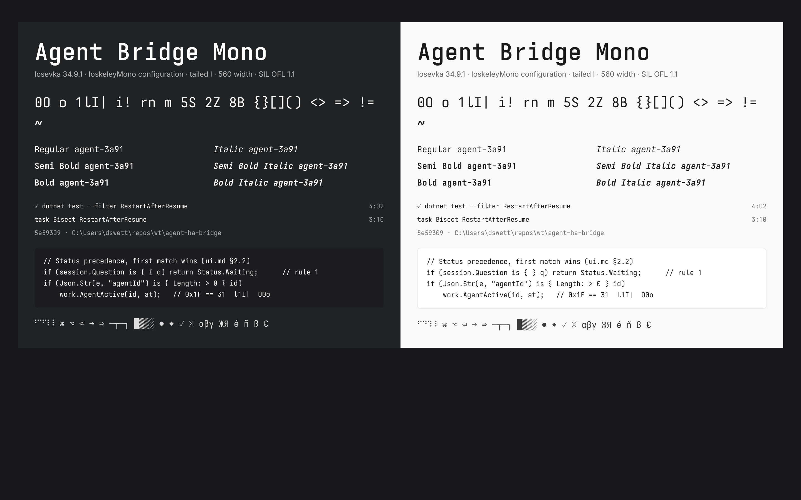

# Agent Bridge Mono

The monospace for every Agent Bridge client: commands, paths, agent IDs, tool calls and
code blocks ([ui.md](../../../docs/design/ui.md) §4.1). Text everywhere else uses the
platform's system face.



## What it is

A modified build of [Iosevka](https://github.com/be5invis/Iosevka) 34.9.1, using the
[IoskeleyMono](https://github.com/ahatem/IoskeleyMono) configuration, which gives it a
Berkeley Mono-like character. Two changes are ours:

- **A tailed lowercase `l`**, so `l`, `1` and `I` stay distinct in agent IDs, hashes and
  paths.
- **A 560 width,** between Iosevka's 500 and IoskeleyMono's 600, so tool lists and the
  inspector fit a little more per line.

Ligatures are off, because code in agent output should show the characters typed.

| Style | Weight | Files |
|---|---|---|
| Regular, Italic | 400 | `ttf/`, `woff2/` |
| SemiBold, SemiBold Italic | 600 | `ttf/`, `woff2/` |
| Bold, Bold Italic | 700 | `ttf/`, `woff2/` |

- **Format:** the TTFs are hinted with ttfautohint, for crisp rendering on Windows.
- **Coverage:** subset to the characters agent output uses: Latin, Greek, Cyrillic,
  punctuation, arrows, maths, box drawing, blocks, geometric shapes, ⌘ ⌥ ⏎, ✓ ✗ and the
  Braille spinners. Anything else falls back to the platform font.
- **Size:** each TTF is about 450 KB, and each WOFF2 about 145 KB.

## Using it

- **PWA:** `@font-face` from `woff2/`, family `"Agent Bridge Mono"`, with the stack
  `"Agent Bridge Mono", "Cascadia Mono", "SF Mono", "Roboto Mono", ui-monospace, monospace`.
- **Windows app:** bundle `ttf/` and reference it as
  `ms-appx:///Fonts/AgentBridgeMono-Regular.ttf#Agent Bridge Mono` (or the unpackaged
  equivalent).
- **macOS and iOS:** add `ttf/` to the bundle and list the files under `UIAppFonts` /
  `ATSApplicationFontsPath`.
- **Android:** use `res/font/`.

The design-tokens generator (#177) owns wiring this into the clients. Don't copy the
files by hand.

## License

The fonts are under the **SIL Open Font License 1.1** ([OFL.txt](OFL.txt)), not the
repository's MIT license. The OFL lets us:
- bundle and embed them in the apps and the PWA;
- keep them in this public repository;
- modify them.

Its conditions:
- **Not sold on their own.** They may ship inside the apps.
- **Modified versions stay under the OFL.**
- **Credit is kept.** Every copyright notice (Iosevka, IoskeleyMono and ours) is kept in
  the files and in OFL.txt.

None of the upstream projects reserves a font name, and ours is distinct anyway.

## Rebuilding

```
./build.sh
```

The script clones Iosevka at the pinned tag, builds from `private-build-plans.toml`, then
runs `postprocess.py`. That step writes all three copyright notices into the name table
and produces `ttf/` and `woff2/`.

- **Needs:** git, Node.js 18+, Python 3 with `fonttools` and `brotli`, and `ttfautohint`.
  `pip install ttfautohint-py` is enough; the script wraps it.
- **Time:** about four minutes on four cores.

To change a glyph, edit the `variants.design` table in `private-build-plans.toml`. The
names are listed in Iosevka's
[custom-build.md](https://github.com/be5invis/Iosevka/blob/v34.9.1/doc/custom-build.md).
Then rebuild, regenerate `specimen.png`, and say what changed in the PR.
