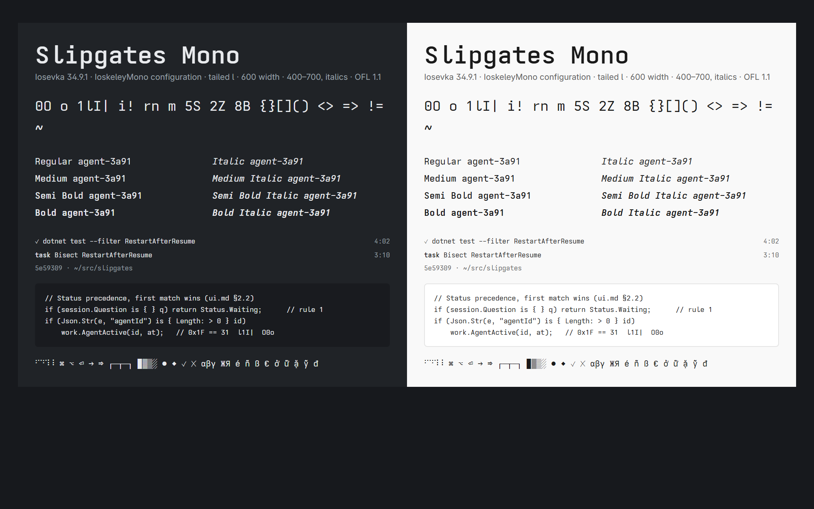

# Slipgates Mono

The monospace for every Slipgates client: commands, paths, agent IDs, tool calls and
code blocks ([ui.md](../../../docs/design/ui.md) §4.1). Text everywhere else is set in its
companion, [Slipgates Sans](../slipgates-sans/) (#544).



## What it is

A modified build of [Iosevka](https://github.com/be5invis/Iosevka) 34.9.1, using the
[IoskeleyMono](https://github.com/ahatem/IoskeleyMono) configuration, which gives it a
Berkeley Mono-like character. One change is ours: **a tailed lowercase `l`**, so `l`, `1`
and `I` stay distinct in agent IDs, hashes and paths.

**Width: 600 units,** IoskeleyMono's own and Iosevka's Extended. The first build was 560,
between Iosevka's 500 and IoskeleyMono's 600, to fit a little more per line. Beside Segoe UI
Variable (then the text face) it looked condensed and clashed with the text, so the owner had
it rebuilt at a normal width (#295). What the eye compares is the advance over the x-height, since inline
mono is scaled to the text's x-height (ui.md §4.2): 560 gave 1.08, narrower than Consolas
(1.12) and Cascadia Mono (1.13); 600 gives 1.15, close to theirs. The x-height itself is
unchanged (520), so inline mono's scale is too.

Ligatures are off, because code in agent output should show the characters typed.

## Faces: real ones only

The ramps use Regular 400, Medium 500, SemiBold 600 and Bold 700, each upright and italic
(`type.weights` × `type.styles` in [tokens.json](../../tokens.json)). **Every one is a real
face, and no platform may synthesize a weight, an italic or an oblique** (ui.md §4.2).
`tools/design-gen` refuses to generate when the family lacks a face the ramps use. Medium was
added on #544, so a medium label beside mono doesn't fall back to a faked weight.

| Style | Weight | Files |
|---|---|---|
| Regular, Italic | 400 | `ttf/`, `woff2/`, `ttc/` |
| Medium, Medium Italic | 500 | `ttf/`, `woff2/`, `ttc/` |
| SemiBold, SemiBold Italic | 600 | `ttf/`, `woff2/`, `ttc/` |
| Bold, Bold Italic | 700 | `ttf/`, `woff2/`, `ttc/` |

- **Format:** the TTFs are hinted with ttfautohint, for crisp rendering on Windows.
  `ttc/SlipgatesMono.ttc` holds all eight in one collection for Windows, so WinUI's family has
  every real face (a single TTF leaves DirectWrite one face to simulate the rest from).
  `faces.json` lists each face's weight, style, PostScript name and collection index.
- **Coverage:** subset to the characters agent output uses: Latin with Vietnamese, Greek,
  Cyrillic, punctuation, arrows, maths, box drawing, blocks, geometric shapes, ⌘ ⌥ ⏎, ✓ ✗ and
  the Braille spinners, 2,971 characters. Anything else falls back to the platform font.
- **Size:** each TTF is about 475–500 KB, each WOFF2 about 147–164 KB, and the collection 3.8 MB.

## Using it

`tools/design-gen` wires it into every client ([design/README.md](../../README.md)); don't
copy the files by hand.

- **PWA:** an `@font-face` per face from `woff2/`, family `"Slipgates Mono"`, with the
  stack `"Slipgates Mono", "Cascadia Mono", "SF Mono", "Roboto Mono", ui-monospace, monospace`
  and `font-synthesis: none`. The licence ships beside them as `SlipgatesMono-OFL.txt`.
- **Windows app:** bundles `ttc/SlipgatesMono.ttc` as `Assets/Fonts/SlipgatesMono.ttc`, named
  `ms-appx:///Assets/Fonts/SlipgatesMono.ttc#Slipgates Mono` by the generated
  `MonoFontFamily`. The self-test asks DirectWrite for every weight and style in it and fails
  on a simulated one.
- **macOS, iOS and iPadOS:** `design/apple/SlipgatesFonts.plist` registers every TTF
  (`UIAppFonts`; `ATSApplicationFontsPath` on macOS), and `design/apple/SlipgatesFonts.swift`
  names each face by PostScript name (`SlipgatesMono-SemiBoldItalic`).
- **Android:** `design/android/font/` holds each TTF and `slipgates_mono.xml`, a font family
  with a `<font>` for every weight and style.

## License

The fonts are under the **SIL Open Font License 1.1** ([OFL.txt](OFL.txt)), not the
repository's AGPL-3.0-only license. The OFL lets us:
- bundle and embed them in the apps and the PWA;
- keep them in this public repository;
- modify them.

Its conditions:
- **Not sold on their own.** They may ship inside the apps.
- **Modified versions stay under the OFL.**
- **Credit is kept.** Every copyright notice (Iosevka, IoskeleyMono and ours) is kept in
  the files and in OFL.txt.

None of the upstream projects reserves a font name, and ours is distinct anyway.

## Rebuilding

```
./build.sh
```

The script clones Iosevka at the pinned tag, builds from `private-build-plans.toml`, then
runs `postprocess.py`. That step writes all three copyright notices into the name table,
names each face's PostScript name after its file, and produces `ttf/`, `woff2/`, `ttc/` and
`faces.json`.

- **Needs:** git, Node.js 18+, Python 3 with `fonttools` and `brotli`, and `ttfautohint`.
  `pip install ttfautohint-py` is enough; the script wraps it.
- **On Windows,** run it from Git Bash, with `python3` on the `PATH` (a one-line script
  that runs the Python holding `fonttools`) and, ahead of it, ttfautohint-py's package
  folder, which holds a real `ttfautohint.exe`: Node on Windows can't start the script's
  shell wrapper. The 600 build was made this way. Rebuilding the old 560 plan the same way
  matched the committed 560 files in all but 7 of 3,409 glyphs: one-unit roundings and a
  few rare symbols (ℭ ↖ ⇖ ♧). The Medium and Vietnamese build (#544) was made the same way.
- **Time:** about five minutes on four cores (seven on Windows) for the eight faces.

To change a glyph, edit the `variants.design` table in `private-build-plans.toml`. The
names are listed in Iosevka's
[custom-build.md](https://github.com/be5invis/Iosevka/blob/v34.9.1/doc/custom-build.md).
Then rebuild, run `node tools/design-gen/generate.mjs`, regenerate `specimen.png`, and say
what changed in the PR. `specimen.png` is
`specimen.html` (beside `woff2/`, served over HTTP so its fonts load) captured at 1000×625
CSS pixels and 2× scale, for example with the PWA's Playwright. `tools/design-gen`'s tests check that every TTF and WOFF2 is the
build plan's width, so a stale build can't ship.
