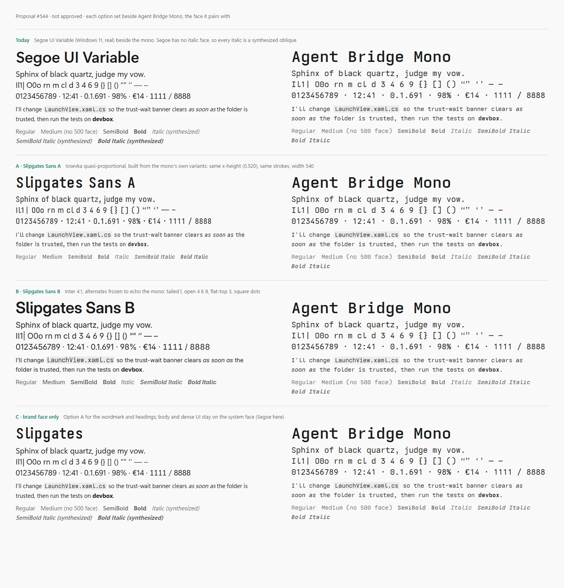

# Slipgates Sans

The text face for every Slipgates client: every piece of text that isn't mono — titles, rows,
responses, metadata, buttons, the wordmark ([ui.md](../../../docs/design/ui.md) §4.1). Code,
paths, IDs and tool calls stay in its companion, [Slipgates Mono](../slipgates-mono/).
Decided on #544 (option B, [the record](../../../docs/design/proposals/544-custom-sans.md)).



## What it is

[Inter](https://github.com/rsms/inter) 4.1, tuned to echo the monospace by freezing five of
Inter's own alternates into the defaults. Nothing is redrawn; Inter's outlines, spacing,
kerning and hinting are untouched.

| Inter feature | Becomes the default | Echoes in the mono |
|---|---|---|
| cv05 | `l` with a tail | the mono's one change: `l`, `I` and `1` stay apart |
| cv02 | open `4` | the semi-open 4 |
| cv03, cv04 | open `6` and `9` | the open-contour 6 and 9 |
| cv09 | flat-top `3` | the flat-top 3 |
| ss07 | square punctuation and dots on `i` and `j` | the square dots |

Freezing points the cmap at each alternate, and gives every single substitution that maps a
default glyph (`tnum`, `case`, `sups`…) the same mapping from the alternate, so tabular figures
keep the frozen shapes. Every client gets them without turning on an OpenType feature, which
WinUI's TextBlock can't do.

Its x-height is 1118/2048 (0.546), which inline mono matches (`type.inlineMono`, ui.md §4.2).

## Faces: real ones only

The ramps use Regular 400, Medium 500, SemiBold 600 and Bold 700, each upright and italic
(`type.weights` × `type.styles` in [tokens.json](../../tokens.json)). **Every one is a real
face, and no platform may synthesize a weight, an italic or an oblique** (ui.md §4.2).
`tools/design-gen` refuses to generate when a family lacks a face the ramps use.

| File | What | Size | For |
|---|---|---|---|
| `ttf/SlipgatesSans.ttf`, `ttf/SlipgatesSans-Italic.ttf` | variable, weight 100–900 and optical size | 629 KB, 651 KB | Apple, Android |
| `woff2/SlipgatesSans.woff2`, `woff2/SlipgatesSans-Italic.woff2` | the same pair, optical size pinned at Text (14) | 173 KB, 187 KB | the PWA |
| `ttc/SlipgatesSans.ttc` | Inter's hinted statics, 400–700 upright and italic, in one collection | 2.07 MB | Windows |
| `faces.json` | each real face: weight, style, PostScript name, collection index, probe advance | | the generator and the Windows self-test |

**Why statics on Windows:** Inter's static files carry hinting, the variable ones don't, and
ClearType at 100% scale renders hinted outlines more crisply. **Why one collection:** WinUI names
a font by one file. With a file per face, DirectWrite sees one face of the family and simulates
the rest; with the collection it finds a real face for each weight and style (measured on #544:
0 simulations from the collection, 6 of 8 from a single file).

**Coverage:** subset to the monospace's ranges: Latin with Vietnamese, Greek, Cyrillic,
punctuation, currency, arrows and maths, 1,561 characters. Box drawing, blocks, Braille and
other symbols Inter doesn't draw fall back, as they would from the system face.

## Using it

Wire it through `tools/design-gen`, never by copying files into a client
([design/README.md](../../README.md)).

- **PWA:** `pwa/design/tokens.css` declares the variable pair with `font-weight: 400 700`, upright
  and italic, and sets `font-synthesis: none` on `:root`. `pwa/tools/build-site.mjs` copies the
  WOFF2s and this licence as `SlipgatesSans-OFL.txt`.
- **Windows:** the app bundles `ttc/SlipgatesSans.ttc` as `Assets/Fonts/SlipgatesSans.ttc`, and the
  generated `SansFontFamily`, `ContentControlThemeFontFamily` and the type ramp name it as
  `ms-appx:///Assets/Fonts/SlipgatesSans.ttc#Slipgates Sans`, then the Segoe UI stack. The
  self-test asks DirectWrite for every weight and style in the collection and fails on a
  simulated one, and checks that XAML draws each as wide as the real face's advances.
- **macOS, iOS and iPadOS:** `design/apple/SlipgatesFonts.plist` registers the variable pair
  (`UIAppFonts`; `ATSApplicationFontsPath` on macOS), and `design/apple/SlipgatesFonts.swift`
  names each real face by PostScript name: `.custom(_:size:relativeTo:)` in SwiftUI and
  `UIFontMetrics` in UIKit, so Dynamic Type still scales it. Ask for a weight or italic through
  `SlipgatesFont`, never `.bold()` or `.italic()` on another face.
- **Android:** `design/android/font/` holds the pair as `slipgates_sans_upright.ttf` and
  `slipgates_sans_italic.ttf` and a font-family XML with a `<font>` for every weight and style,
  each set to its weight by `fontVariationSettings` (API 26+). Sizes stay in `sp`, so the
  system's font scale, nonlinear to 200% on Android 14, still applies. In Compose, use the same
  faces with `FontSynthesis.None`.

## License

**SIL Open Font License 1.1** ([OFL.txt](OFL.txt)), not the repository's AGPL-3.0-only. Inter
reserves no font name, so the OFL doesn't require a new one; it is renamed so a modified Inter
isn't mistaken for Inter. Slipgates Sans reserves no name either. It may ship inside the apps but
not be sold on its own, and a modified version stays under the OFL with both copyright notices.

## Rebuilding

```
python build.py <unzipped Inter-4.1 release>
```

Download Inter 4.1's release zip from GitHub and unzip it. The script needs Python 3 with
`fonttools` and `brotli`, takes under a minute, and writes `ttf/`, `woff2/`, `ttc/` and
`faces.json` (the docstring says what each step does). Then run
`node tools/design-gen/generate.mjs`: it checks `faces.json` against the tokens, and regenerates
the Android copies and the probe advances the self-test reads.
