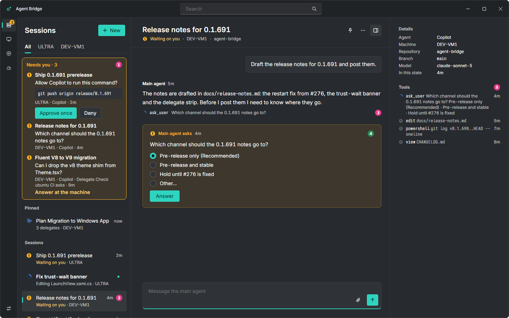
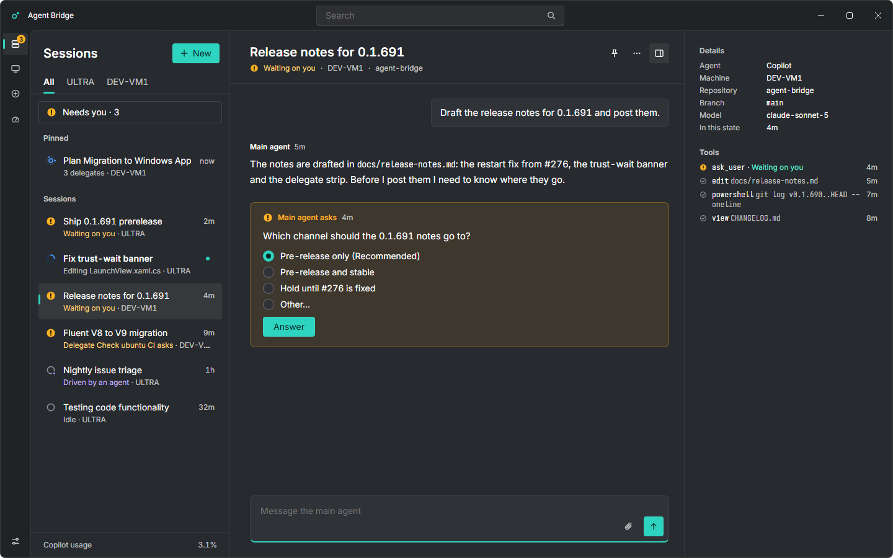
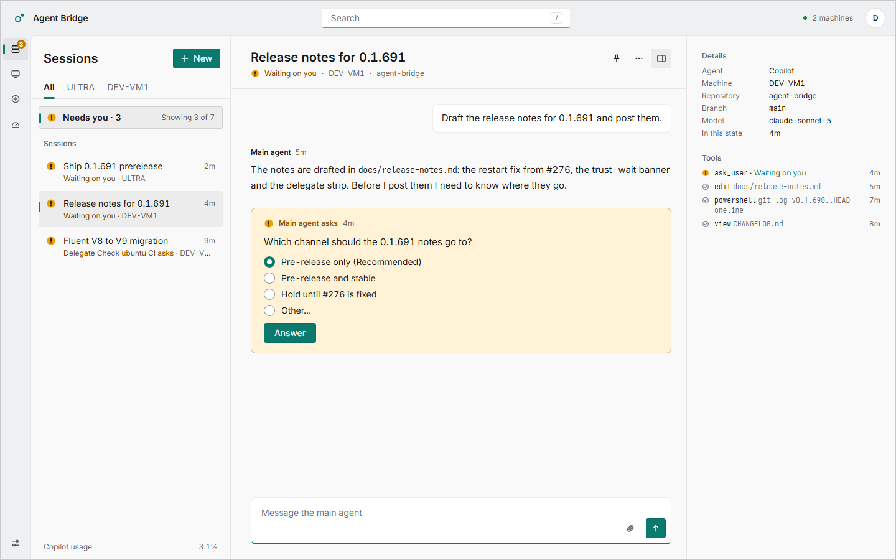
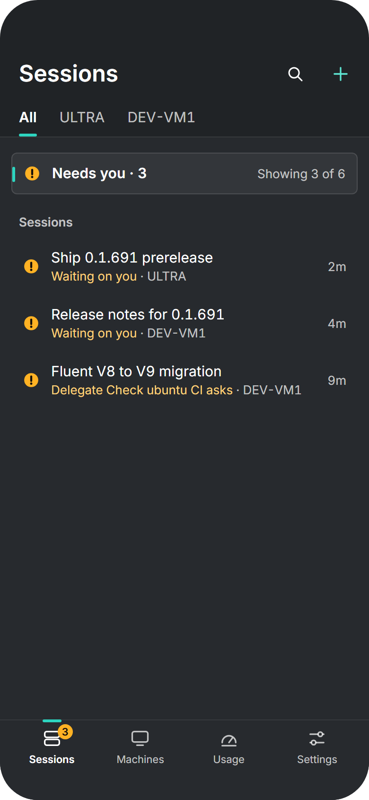
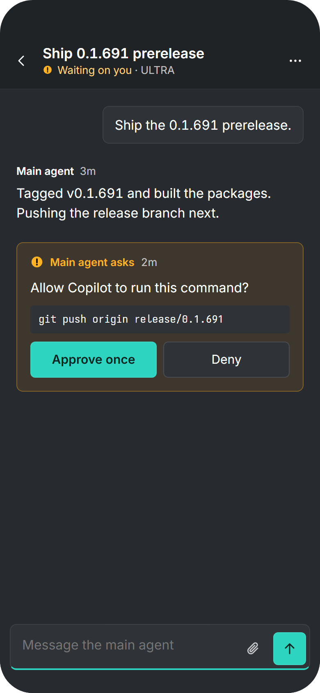

# Proposal #253: one row, one question

*Status: a draft for the owner, from the UI track on 2026-11-02. Nothing here is the spec yet:
[ui.md](../ui.md) stays as it is until the owner signs this off, and §5 lists the exact edits that
sign-off would make.* Issue: [#253](https://github.com/danswett/agent-bridge/issues/253).

The mock-ups are in [253-attention/](253-attention/), drawn from boards in
[`/design/canvas`](../../../design/canvas) (`Proposal-253-*.dc.html`) with
[tools/design-mockups](../../../tools/design-mockups/README.md). Like every mock-up, they are
reference: where they and this page disagree, this page wins.

## 1. The problem

The owner's Windows screenshot shows one pending question drawn up to five times at once. Each
repeat is what ui.md asks for: this is a design problem, not a rendering bug, and shrinking
padding would not fix it.

| # | Where | What it repeats | The clauses that put it there |
|---|---|---|---|
| 1 | The **Needs you lane** at the top of the list | The session's title, the question's first line (or, for an approval it can answer, the **whole prompt**, up to 600 characters and 12 lines), machine, agent and age, and Approve once / Deny | §1 principle 2 ("Only a question floats, into Needs you"); §6.1 item 1 ("one entry per pending question", "Approvals … can be answered inline … The action is the whole prompt"); §5.3 catalogue: *Arriving and leaving* (a Needs you entry) and *Send and Answer* (Approve once and Deny in Needs you) |
| 2 | The session's own **row**, further down the same list | The same session, "Waiting on you" | §6.1 item 1 ("The lane references sessions; it never moves their rows") together with §2.2 rule 1, which applies to the row. The row is right; the pair is the duplicate |
| 3 | The **"Now" line** under the main agent's reply | `ask_user` and its summary, which is the question; for an approval, the command it holds | §6.4 *Now* ("the tool the main agent is running … the tool's name and arguments in mono"). While a session waits, its running tool is the `ask_user` call (the PWA keeps `currentTool` while `waiting`, `pwa/js/protocol.js`), and a tool's `summary` is "a short form of its main argument" |
| 4 | The **question card** in the conversation | (the question itself) | §6.4 *Questions*. This is the one to keep |
| 5 | The inspector's **Tools** | `ask_user` with the question again, wrapped, never cut | §6.2 Details ("Tools (each call: glyph, name and arguments in mono, age)"), drawn wrapped by `ToolList.xaml` and the PWA's history |

The lane also breaks principle 4 ("Panes, not expanding cards"): an approval's entry grows to
hold its whole prompt and two buttons, so the list's first section is a stack of cards whose
height follows what agents ask. The signed-off board draws the lane as one-line entries, but
§6.1's inline approval needs the whole prompt on screen, so the implementation grew.

The header's "Waiting on you" (§6.2) is not a repeat: it says the state, not the words, and it
orients a person who arrived from anywhere. It stays.

Before, on Windows, with the repeats numbered (pink) and the one to keep (green):



## 2. What the lane bought, which a redesign must keep

U2 (#165) gave the lane these properties. Every option below is measured against them.

1. **Attention across machines, without rows moving** (principle 2, #164): whatever machine the
   list shows, you see that something waits elsewhere.
2. **One count everywhere:** the Windows tray's tooltip and the Sessions badge, and the PWA's app
   badge, are the lane's count (`MainViewModel.Waiting`, `AppBadge`).
3. **Approve once without opening the session,** for a Copilot approval, and only where the
   whole prompt is drawn as it runs: the lane refuses a prompt with bidi controls, zero-width,
   format or other default-ignorable characters, controls other than newline and tab, private-use
   or unassigned code points, U+2028/2029, right-to-left letters, a link whose words hide its
   address, a fence the agent's words could close, a table, one too long to show whole, or one
   from an agent whose prompt can reach the host cut short (`NeedsYou.cs`, `pwa/js/needs-you.js`).
4. **One request:** the lane's Approve once and Deny are the card's own buttons (the same
   `QuestionViewModel` and `AnswerService` entry), so progress and outcomes (stale, busy,
   refused, Try again) show in both and a second press sends nothing.
5. **Accessible and reachable:** each control is named for its session and machine ("Approve once:
   Ship 0.1.691 prerelease on ULTRA"), 44 px tall on a phone, keeps focus while the lane redraws,
   says its outcome through a polite live region, and opening an entry moves focus into the card.
6. **Honest when it can't:** an `answerAtMachine` question says so and offers nothing to press,
   and a delegate's question names the delegate after the word "Delegate" (§6.3).

## 3. Options

The options differ in the list. The changes to the conversation's Now line and to Tools (§4.3,
§4.5) remove repeats 3 and 5 whichever is chosen.

### A. Needs you as a filter; the question only in the conversation (recommended)

- The lane goes. In its place is a single toggle at the top of the list, **Needs you · N**,
  shown while anything waits.
- Pressing it narrows the list to the rows waiting on you, in their own places and order.
  Nothing moves, and no second set of entries is drawn.
- N is still every machine's count, and is still the tray's and the badges' count.
- Choosing a row opens its session at its question, which is the only full presentation of
  that question, and the only place it is answered.
- Tools and the inspector say that a question waits and link to it. They never repeat it.

| For | Against |
|---|---|
| Nothing is drawn twice: one row per session, one question per question | Approve once leaves the list. On a desktop the question is in the pane beside the list, so it is one click on the row, then Approve once. On a phone it is two taps where the lane took one |
| One place answers, so the security checks live in one place (§4.4), and there is one set of controls to test and keep accessible | The card must take over the lane's protections for drawing a prompt as it runs. Today it draws an approval as Markdown, as any question (§4.4) |
| Principles 2 and 4 hold as written. The list's height no longer depends on what agents ask | The count no longer sits beside the words it counts. The filter is one press away |
| The same at every width and on every platform: a toggle and rows | |

### B. A compact lane of references

Keep a Needs you section, but make each entry one line (glyph, title, age) with no question text
and no buttons. Choosing it opens the question.

| For | Against |
|---|---|
| Glanceable without pressing anything | Every waiting session still has two rows, which is the issue's main complaint |
| The smallest change to U2's code | The list below shifts down a line for each question (it doesn't reorder, but it moves on screen) |
| | Inline approval goes anyway, since a one-line entry can't show the whole prompt. Keeping it brings the big entry back |

### C. A filter, plus a review sheet on the row

Option A, plus, on a row whose question U2 would have approved inline, a trailing **Review**
button. It opens a flyout (desktop) or a bottom sheet (phone) holding the whole prompt with
Approve once and Deny, through the card's model and with U2's refusals.

| For | Against |
|---|---|
| Keeps approving from the list on a phone without opening the session | The prompt is drawn a second time (if only while the sheet is open), and there are two answer surfaces to keep identical and secure: the burden U2 carried |
| Inline approval keeps its gate, so nothing approves what isn't on screen | A row gains a control, though rows are navigation (§6.1). A row with a button inside a list item is harder to use with a keyboard and a screen reader |
| | The most to build and test |

### Side by side

| | Today | A | B | C |
|---|---|---|---|---|
| Times the question's words are drawn | Up to 4 | **1** | 1 | 1, plus the sheet while open |
| Rows per waiting session | 2 | **1** | 2 | 1 |
| Approve from the list | Yes | No: one more step | No | Yes, through the sheet |
| Taps to approve on a phone | 1 | 2 | 2 | 2 (Review, then Approve once) |
| Surfaces that send an answer | 2 | **1** | 1 | 2 |
| Principle 4 (no expanding cards) | Broken | Holds | Holds | Holds; the sheet is a sheet |

C saves no taps over A on a phone: Review, then Approve once, against the row, then Approve once.
What it saves is leaving the list. A gets close to that by landing on the question, and by the
filter, which keeps the next one a Back away.

## 4. The recommendation in detail (option A)

After, on Windows (list unfiltered), on the desktop PWA with Needs you on, and on a phone:





| List, Needs you on | Session, at its question |
|---|---|
|  |  |

Every state, below, is on [the states board](253-attention/proposal-253-states.png)
([light](253-attention/proposal-253-states-light.png)).

### 4.1 Needs you · N, in the list

- **What:** a toggle button, one line, the list's first item above Pinned, under the machine
  tabs:
  - its leading glyph is `needs` while anything waits, and `idle` at none;
  - then "Needs you · N", the separator kept with "Needs you" (§6.1, #214).
  - A toggle, not a status: it takes the platform's button styling and never a status colour
    (§3: "Status colours are never used on controls").
  - Pressed, it takes the selection's look: the quiet fill and the 3×16 Bridge pill, with
    semibold words. It adds "Showing N of M" at its trailing edge, or "N on *machine*" when a
    machine is chosen.
  - Windows: a `ToggleButton` in the list's header, 36 px tall. PWA: a `button` with
    `aria-pressed`, 36 px on a desktop and 44 px on a phone.
- **When it shows:** whenever anything waits, and whenever it is pressed. Nothing waiting and not
  pressed, it isn't drawn: the list starts at Pinned.
- **What N counts:** pending questions on every machine connected, whatever the machine tabs
  show. It is the same number as the tray's tooltip, the Sessions badge and the PWA's app badge
  (§4.8).
- **Pressed:**
  - The list shows only the rows waiting on you, in Pinned and Sessions, in their own order and
    under the Sort menu's choice. Groups with none, and Ended, are hidden.
  - **Nothing moves.** A row whose question is answered while the filter is on stays where it is,
    with its new glyph and words, until the filter is turned off or pressed again. A list must
    not close up under the pointer.
  - A question arriving adds its row where that row lives. It fades in (§5.3 *Arriving and
    leaving*), and its neighbours take their places at once.
  - **With a machine chosen,** the filter narrows that machine's rows. N is still every machine's,
    and the toggle says "1 on ULTRA". When others wait elsewhere, the list ends with one secondary
    button, "2 more on other machines", which chooses All. The global count is never hidden
    behind a machine.
  - Nothing left waiting: the toggle reads "Needs you · 0" with the `idle` glyph, the rows
    already shown stay, and a meta line under them says "Nothing else needs you".
- **Kept:** for as long as the app runs, not across restarts (question 5).

### 4.2 The row

- **Unchanged:**
  - one row per session, in your order;
  - the `needs` glyph;
  - line 2's status from §2.2 ("Waiting on you" by rule 1, "Delegate *name* asks" by rule 2),
    then the machine.
- **It never carries the question's words** (question 6).
- **Choosing a waiting row opens its session at its question,** whether or not the filter is on:
  - The conversation scrolls to the question (§5.3 *Scroll to a question*), and switches to the
    Conversation tab from Delegates or Tools.
  - A click, a tap or Enter moves keyboard focus to the question's heading, as opening a lane
    entry does today (`NeedsYouEntry.Open`, `WantsFocus`). The next Tab is in the question.
  - Arrow keys still only move the selection, so going down the list with a keyboard isn't
    pulled into each session.
- **More than one question in a session:** protocol v1 carries one (`session.question`), so the
  count of questions is the count of rows. If a host ever sends several:
  - the row's status reads "N questions waiting";
  - N in Needs you counts each question;
  - the session's conversation shows one card per question, in the order asked, with "1 of 2"
    in each heading.

### 4.3 The question, in the conversation

- **The only full presentation.** The card is as §6.4 has it:
  - its heading is "Main agent asks" or "Delegate *name* asks";
  - then the whole question, with the platform's own controls and Answer, or Approve once and
    Deny.
- **One card per question id.** An update to the same question (a host re-sending it, or its
  `truncated` flag changing) updates the card in place. It never adds a second card.
- **The Now line gives way.** While the session waits on its question (rule 1 or 2), the
  conversation doesn't show the running tool's line above it. The card says what is happening.
- **Answered:** the card quietens, with no Needs you fill and the `done` glyph:
  - it reads "Main agent asked", then the question, then "You answered *Pre-release only* · 1m";
  - it stays in the conversation as long as the session's activity holds it;
  - an answer sent from another device, or at the machine, shows what the host reports, as
    today's receipt does.
- **Answer at the machine:**
  - the card shows the whole question with no controls, and one line in Needs you's text colour:
    "Answer at the machine · DEV-VM1";
  - leaving the session, or turning the filter off, never counts as an answer. The row keeps its
    glyph until the host clears the question.
- **A delegate's question** is drawn the same way, under "Delegate *name* asks". A Copilot
  sub-agent's `ask_user` is always `answerAtMachine` (protocol, Question `agent`), so it has no
  controls.

### 4.4 Approve once, only on the card, with the lane's protections

The card becomes the only place that sends an answer. So the guarantee the lane gave its own
Approve once, that what is approved is exactly what is drawn, moves to the card for every
approval:
- **Characters not drawn where they run** are drawn as visible escapes (`\u202E`), in Danger's
  text colour inside a hairline box, in the order they run. These are: bidi controls,
  zero-width, format and other default-ignorable characters, controls other than newline and
  tab (a CR too), private-use and unassigned code points, and U+2028/2029. The lane's `reveal()`
  and `NeedsYouEntry.Reveal` already do this. Approve once is still offered, because what it
  allows is now on screen (question 3).
- **Right-to-left letters** in an approval's code are drawn in the order they run (left to right,
  with no reordering): CSS `unicode-bidi: bidi-override` in the PWA, and an LRO added for display
  in WinUI, never sent.
- **A prompt not shaped as a host writes a permission** is drawn literal, as plain monospace
  text, rather than as Markdown. That covers a link whose words aren't its address, a fence
  in the prose, a fence not last, or an info string other than none, json or diff
  (`literalShape`). Nothing can hide behind a link's words or a fence the agent's own words
  closed.
- **Length:** the card wraps and never cuts, so a long command or an edit's diff is shown whole
  and Approve once stays. U2's 600-character and 12-line cap was the lane's room, not a
  security rule.
- **Unchanged on the card:**
  - a prompt that reached the device cut short (`truncated`) still can't be answered from here;
  - `answerAtMachine` has no controls;
  - Codex approvals behave as they do today.

### 4.5 Tools, and the delegate inspector

- **The `ask_user` call whose id is the pending question's** (Question `id` is "the id of the tool
  call that asked it") is one line with no arguments:
  - the `needs` glyph, `ask_user` in mono, then "Waiting on you" as a link that goes to the
    question, then the age;
  - answered, the `done` glyph and "Answered": a link while the conversation holds the question,
    and plain words after.
- **Every other `ask_user` call** shows "Answered" the same way, never its arguments.
- **Its arguments, for diagnosis:** "Show arguments" in the row's menu (right-click, long press,
  Shift+F10) discloses them under the row (§5.3 *Disclosure*). They are closed by default and
  never open on their own.
- **The call an approval holds** (say `powershell git push …`) keeps its name and arguments: it is
  the action, not the question, and a permission prompt's id (`<requestId>#<digest>`) names no
  tool call to link from.
- **The "Now" line elsewhere,** and Tools while nothing waits, are unchanged.
- **A delegate that asks:**
  - its strip item or chip shows the `needs` glyph;
  - its inspector's Status reads "Asks you" as a link to the question, with "· answer at the
    machine" when so;
  - Task and Latest never repeat the question.

### 4.6 The session header

Unchanged: glyph · status words · machine · repository (§6.2). "Waiting on you" is not a link.
Choosing the row already lands on the question, and the header isn't the place for a second way.

### 4.7 Narrow layouts

| Width | List | Session |
|---|---|---|
| ≥ 1280 | The toggle above Pinned. Choosing a waiting row shows its session beside the list, scrolled to the question | Inspector Tools: the linked `ask_user` row |
| 760–1279 | The same | Conversation tab chosen. The Tools tab has the linked row |
| < 760 | The toggle, 44 px tall, above Pinned | Pushed, at the question, with focus on its heading. Back returns to the list, still filtered, with the row chosen |

### 4.8 The count, tray and badges

- **The count is the model's, not a view's.** Today it is the lane's entries (`NeedsYou.Count`,
  `NeedsYouLane.count`). It moves to the pending questions across cards (`MainViewModel.Waiting`,
  and in the PWA a small `attention()` over every machine's sessions), in the same order.
- **What carries it, unchanged:**
  - the Windows tray tooltip ("Agent Bridge · 3 need you");
  - the rail's Sessions badge, and the phone's Sessions tab badge;
  - the PWA's app badge (Badging API).
- **Toasts and Web Push are unchanged.** Opening one lands on the question, as choosing the row
  does.

### 4.9 Accessibility

- **The toggle:**
  - it is a button with a pressed state (`aria-pressed`; WinUI `ToggleButton`);
  - its name is "Needs you, 3 on every machine", or "Needs you, 1 on ULTRA, 3 on every machine"
    with a machine chosen;
  - the list region it narrows is named "Sessions, needing you" while the filter is on.
- **Announcements:** a change in N is announced once through a polite live region ("3 need
  you"), at most every 5 seconds, so a burst of questions is one announcement. Nothing is
  announced while the person types in the reply box.
- **Rows** read as today (§9): "Release notes for 0.1.691, waiting on you, DEV-VM1".
- **The question:**
  - its heading (level 3) is where focus lands, and its accessible description is the question's
    first line;
  - Approve once and Deny keep U2's names ("Approve once: *title* on *machine*");
  - the answer's outcome is announced through the card's live region, as today.
- **Keyboard:** Tab reaches the toggle after the machine tabs and before the list, and Space or
  Enter toggles it. Arrows move in the list, Enter opens a row at its question, and Ctrl/⌘+K
  still focuses search.
- **Targets:** 44×44 on touch, and 32×32 on desktop (the toggle is 36).
- **High contrast:**
  - the toggle uses the system's button colours (ButtonFace and ButtonText, with Highlight and
    HighlightText pressed);
  - the `needs` glyph maps to `Highlight` (`tokens.json` `color.role.needs.hc`);
  - the escape box uses Danger's high-contrast mapping, and the Tools link is a system
    hyperlink (LinkText; `HyperlinkButton`).
  - The canvas has no high-contrast theme, so these are specified here and checked in each
    client's PR with `forced-colors` and Windows' contrast themes.
- **Reduced motion:** as §5.3. The row fading in is a cross-fade, and the scroll to the
  question is a jump.

### 4.10 Other platforms, later

- macOS: the sidebar's "Needs You" source-list section becomes a "Needs You" item at the top
  that filters the list.
- iOS: a filter in the toolbar's filter menu, with its count.
- Android: the first filter chip.

None of these apps exist yet. Their boards are redrawn in the spec PR (§6).

### 4.11 Every board

Rendered from `design/canvas/Proposal-253-*.dc.html`. Pink numbers mark a repeat, and green the
one presentation kept. High contrast isn't drawn: the canvas has no such theme (§4.9).

| Board | Dark | Light |
|---|---|---|
| Windows, before | [dark](253-attention/proposal-253-windows-before.png) | [light](253-attention/proposal-253-windows-before-light.png) |
| Windows, after | [dark](253-attention/proposal-253-windows.png) | [light](253-attention/proposal-253-windows-light.png) |
| PWA desktop, before | [dark](253-attention/proposal-253-pwa-desktop-before.png) | [light](253-attention/proposal-253-pwa-desktop-before-light.png) |
| PWA desktop, after, Needs you on | [dark](253-attention/proposal-253-pwa-desktop.png) | [light](253-attention/proposal-253-pwa-desktop-light.png) |
| PWA phone list, before | [dark](253-attention/proposal-253-phone-before.png) | [light](253-attention/proposal-253-phone-before-light.png) |
| PWA phone list, after, Needs you on | [dark](253-attention/proposal-253-phone.png) | [light](253-attention/proposal-253-phone-light.png) |
| PWA phone session, before | [dark](253-attention/proposal-253-phone-session-before.png) | [light](253-attention/proposal-253-phone-session-before-light.png) |
| PWA phone session, after | [dark](253-attention/proposal-253-phone-session.png) | [light](253-attention/proposal-253-phone-session-light.png) |
| States | [dark](253-attention/proposal-253-states.png) | [light](253-attention/proposal-253-states-light.png) |

## 5. The ui.md edits sign-off would make (not applied)

```diff
 ## 1. Principles
-2. **Order is yours.** Rows never move on their own. Only a question floats, into Needs
-   you, and its row stays where it is (#164, #165).
+2. **Order is yours.** Rows never move on their own, not even for a question: its row shows
+   it in place, and Needs you · N narrows the list to the rows waiting on you (#164, #253).
+   A question's words are drawn once, in the conversation.
```

```diff
 ### 5.3 Motion (catalogue)
-| Arriving and leaving | A session row, a Needs you entry, a delegate in the strip | A host adds or removes it; a question is asked or answered | …
+| Arriving and leaving | A session row (also as Needs you shows or hides it), a delegate in the strip | A host adds or removes it; a question is asked or answered; Needs you is turned on or off | …
-| Send and Answer | The reply box; a question card; Approve once and Deny in Needs you | Send, Answer, Approve once, Deny | …
+| Send and Answer | The reply box; a question card | Send, Answer, Approve once, Deny | …
-| Scroll to a question | … | A question arrives while the person is at the end of the conversation; a toast, the tray or a Needs you entry opens a session | …
+| Scroll to a question | … | A question arrives while the person is at the end of the conversation; a toast, the tray or a waiting row opens a session | …
 **Not in the design:**
-- **Loops** … no pulsing dot, badge or Needs you entry, …
+- **Loops** … no pulsing dot, badge or Needs you toggle, …
```

```diff
 ### 6.1 Session list
 Sections, top to bottom:
-1. **Needs you · N** (#165): one entry per pending question across machines, oldest first.
-   - Each entry shows: …
-   - Approvals (`kind: approval`, not `answerAtMachine`) can be answered inline: … opens the session instead.
-   - Forms open the session. `answerAtMachine` entries say so and have no controls.
-   - The lane references sessions; it never moves their rows.
-   - Its count is the app's badge: the Windows app's tray and Sessions badge, and the PWA's
-     app badge where the browser has one.
+1. **Needs you · N** (#165, #253): a toggle, not a lane. Shown while any question waits, or while
+   it is pressed.
+   - N counts pending questions on every machine connected, whatever the machine tabs show. It
+     is the app's badge: the Windows app's tray and Sessions badge, and the PWA's app badge where
+     the browser has one.
+   - Pressed, the list shows only the rows waiting on you, in their own groups and order. A row
+     answered meanwhile stays where it is until the filter is turned off. With a machine chosen,
+     it narrows that machine's rows, says "N on *machine*", and ends with "N more on other
+     machines", which chooses All.
+   - It draws no question's words and offers no answer. Choosing a waiting row, filtered or not,
+     opens its session at the question (§6.4), and a click, tap or Enter puts focus on the
+     question's heading.
 2. **Pinned.**
 3. **Sessions,** in your order (#164).
 4. **Ended · N,** collapsed.
@@ Row anatomy
 - **Never on a row:** the model, the repo SHA, turn and compaction counts, or the pid.
-  Those live in session details.
+  Those live in session details. Nor a question's words: they are in the conversation.
```

```diff
 ### 6.2 Session header
 - **Details** is a property list: …
-  At three panes it heads the inspector, over Tools (each call: glyph, name and arguments in
-  mono, age).
+  At three panes it heads the inspector, over Tools (each call: glyph, name and arguments in
+  mono, age). An `ask_user` call has no arguments there: it reads "Waiting on you", a link to
+  its question, or "Answered". "Show arguments" in the row's menu discloses them, for diagnosis.
```

```diff
 ### 6.3 Delegates (#84)
 - **Inspector:**
   - the delegate's name and glyph;
-  - a property list: Status, Model, Kind (background or task), ID (mono);
+  - a property list: Status, Model, Kind (background or task), ID (mono). A delegate that asks
+    has Status "Asks you", a link to its question, never the question itself;
```

```diff
 ### 6.4 Conversation
-- **Questions:** in the stream, as a card in Needs you colours. The header reads "Main agent
-  asks" or "Delegate *name* asks", followed by the question and the platform's own radio,
-  checkbox and text controls, with Answer in Bridge.
-- **Now:** the tool the main agent is running, as a meta line under its reply (glyph, then the
-  tool's name and arguments in mono).
+- **Questions:** in the stream, as a card in Needs you colours, the one place a question's words
+  are drawn and the one place it is answered. The header reads "Main agent asks" or "Delegate
+  *name* asks", followed by the question and the platform's own radio, checkbox and text
+  controls, with Answer in Bridge, or Approve once (Bridge) and Deny.
+  - One card per question id: an update to it changes the card in place.
+  - An approval is drawn as it runs. A character not drawn where it runs (bidi controls,
+    zero-width, format and other default-ignorable characters, controls but newline and tab,
+    private-use or unassigned code points, U+2028/2029) is a visible escape (`\u202E`). Its
+    code keeps right-to-left letters in the order they run. A prompt not shaped as a host writes
+    a permission (§6.1's old rule: prose, then at most one fenced block ending it, its fence
+    naming no language but json or diff, and no link whose words hide where it goes) is drawn
+    as literal text, not Markdown.
+  - `answerAtMachine`: the question, no controls, and "Answer at the machine · *machine*".
+    Leaving it is never an answer.
+  - Answered, it quietens ("Main agent asked", the `done` glyph) and shows what was sent, for as
+    long as the session's activity holds it.
+  - Several at once (if a host sends them): one card each, in the order asked, "1 of N" in the
+    heading.
+- **Now:** the tool the main agent is running, as a meta line under its reply (glyph, then the
+  tool's name and arguments in mono). Not while the session waits on a question: the card says
+  what is happening.
```

```diff
 ## 7. Platform shells
 **macOS (SwiftUI, later):**
-- **Sidebar:** a translucent source list (Needs You, Pinned, Sessions, Machines), 28 px
-  rows, and a Bridge fill on the selected row.
+- **Sidebar:** a translucent source list (a Needs You filter item, Pinned, Sessions,
+  Machines), 28 px rows, and a Bridge fill on the selected row.
@@ iOS
-- **Sessions:** large title with the filter and New buttons on the title row …
+- **Sessions:** large title with the filter (whose first choice is Needs you · N) and New
+  buttons on the title row …
@@ Android
-- **Sessions:** a Material 3 search bar, filter chips, list items, …
+- **Sessions:** a Material 3 search bar, filter chips (Needs you · N first), list items, …
```

```diff
 ## 9. Accessibility
-- **Keyboard:** desktop lists move with arrows, Alt+↑/↓ reorders (#164), Shift+F10 or the
-  menu key opens a row's menu, and Ctrl/⌘+K focuses search.
+- **Keyboard:** desktop lists move with arrows, Alt+↑/↓ reorders (#164), Shift+F10 or the
+  menu key opens a row's menu, and Ctrl/⌘+K focuses search. Needs you · N is a toggle in the
+  tab order before the list. Enter on a waiting row puts focus on its question's heading.
+- **Announcements:** a change in the Needs you count is said once, politely, at most every 5 s
+  ("3 need you").
```

```diff
 ## 10. Mock-up index
-| iOS Sessions / Session · dark / light | List with Needs you; session with the delegate sheet |
+| iOS Sessions / Session · dark / light | List with the Needs you filter; session with the delegate sheet |
```

The *Status* paragraph at the top of ui.md would record the owner's sign-off of this change and
its date, as it does for #183 and #232.

## 6. What changes in each client, and the slices

| Slice | What | Touches |
|---|---|---|
| **0. This PR** | The proposal and its boards. No client code | `docs/design/proposals/`, `design/canvas/Proposal-253-*`, `tools/design-mockups/render.js` (renders proposals apart) |
| **1. Spec** (after sign-off) | Apply §5 to ui.md. Redraw the Windows, PWA desktop, PWA phone, macOS, iOS and Android boards without the lane. Re-render `docs/design/mockups`. Retire the proposal boards. Add U10 (#253) to ui-plan.md | `docs/design/ui.md`, `ui-plan.md`, `design/canvas`, `docs/design/mockups` |
| **2. PWA** | Below | `pwa/` |
| **3. App** | Below | `src/AgentBridge.App`, `src/AgentBridge.App.Core`, `tests/AgentBridge.App.Tests` |

Slices 2 and 3 can run together after 1. Each links the other, and they land close together
(ui-plan.md §2.4). **Both are security-sensitive** under AGENTS.md: they change what a remote
device approves on a machine. So each takes an independent security review before merge.

**PWA (slice 2):**
- `pwa/js/needs-you.js` keeps the model:
  - the count and its ordering;
  - `wholePrompt`, `literalShape`, `reveal`, the hidden and right-to-left tests, and
    `decisions`, which the question card now uses.
- `ui/needs-you-view.js` (the lane) is replaced by a toggle in `ui/sessions-page.js`, with the
  filter predicate beside the order in `session-order.js`. `AppBadge` takes the model's count.
- `ui/question-view.js` draws an approval as §4.4 says: escapes, literal shape and
  bidi-override.
- `ui/session-card.js`:
  - drops the Now line while waiting;
  - draws the linked `ask_user` row in Tools, with Show arguments in its menu;
  - lands focus on the question when opened from a waiting row.
- `ui/delegates-view.js` gets the Status link.
- The lane's markup in `index.html` and its rules in `app.css` go.

**App (slice 3):**
- `App.Core`:
  - `NeedsYouEntry`'s checks (`WholePrompt`, `LiteralShape`, `HasHidden`, `HasRightToLeft`,
    `Reveal`) move to an `ApprovalPrompt` helper that `QuestionViewModel` uses;
  - `MainViewModel.NeedsYou` becomes a `NeedsYouFilter` (pressed, N, "N on *machine*") and a
    filter over `Sessions`, with `Waiting` from the cards;
  - `SessionCardViewModel` gets `ShowNowLine` and an `ask_user` `ToolRow` with a question link;
  - `Delegates.cs` gets the Status link.
- `App`:
  - in `SessionsPage.xaml`, the `ListView.Header` lane becomes a `ToggleButton`;
  - `QuestionView.xaml` draws the escapes and the literal shape;
  - `ToolList.xaml` gets the link row and Show arguments in a context menu;
  - in `SessionView.xaml`, the Now line hides while waiting;
  - the tray and Sessions badge bind to `Waiting`, unchanged.
- `SelfTest` checks follow.

**Tests (both clients):**
- U2's refusal tests are carried to the question card, not dropped. Each one keeps its case and
  now asserts how the card draws it.
- Names read as sentences, in `pwa/test` (unit and Playwright at 390, 900 and 1440 px, light,
  dark and `forced-colors`) and in `App.Tests` (`NeedsYouTests` becomes `AttentionTests`), plus
  `SelfTest` on Windows:

- **Security (approvals):**
  - an approval whose command holds a bidi control, a zero-width space, U+2028, a private-use
    character, a CR or a variation selector draws each as a visible escape on the card, in the
    order it runs;
  - an approval whose command holds right-to-left letters draws them in the order they run, not
    reordered;
  - an approval whose prompt a link or a fence could make draw differently is drawn as literal
    text, not Markdown;
  - Approve once sends the request for exactly the question id shown, and nothing in the list
    sends an answer (no list control is wired to the answer service);
  - a prompt that arrived cut short still can't be answered from here;
  - an `answerAtMachine` question has no controls.
- **The list:**
  - Needs you counts pending questions on every machine, whatever machine the list shows, and
    the tray, the Sessions badge and the app badge carry the same number;
  - turning Needs you on hides the rows not waiting and moves none of the rest;
  - a row answered while Needs you is on stays where it was until the filter is turned off;
  - with a machine chosen, Needs you narrows that machine's rows and offers the rest on other
    machines;
  - the toggle is absent with nothing waiting, and stays while pressed;
  - a waiting row never shows its question's words.
- **The question:**
  - choosing a waiting row opens its session at the question, with focus on its heading, at every
    width;
  - an update to the same question id changes its card in place, and never adds a second;
  - the Now line gives way to the question while the session waits on it;
  - an answered question stays in the conversation, quiet, with what was sent.
- **Tools and delegates:**
  - the `ask_user` call in Tools names no arguments, links to its question, and Show arguments
    discloses them;
  - a delegate that asks has a Status link to its question, and its question shows once.
- **Accessibility:**
  - the toggle is named for its count and scope and reports its pressed state;
  - a change in the count is announced once, at most every 5 seconds;
  - every control on a phone is at least 44 px tall.

## 7. Questions for the owner

1. **Which option:** A (a Needs you filter, and the question only in the conversation), B (a
   one-line lane) or C (A, plus a review sheet on the row)? Recommended: A.
2. **Approving from a phone:** with A, approving takes two taps (the row, then Approve once on
   the question) where the lane took one. Is that acceptable, or do you want C's review sheet?
3. **Hidden characters:** when an approval's command holds a character that isn't drawn where it
   runs (a bidi control, a zero-width space, right-to-left letters), the lane refused Approve
   once. On the card, should it draw the character as a visible escape and still offer Approve
   once (recommended), or offer only Deny and say to answer at the machine?
4. **Order in the filter:** keep your order (recommended, as principle 2), or oldest first, as
   the lane was?
5. **Remembering it:** should Needs you stay on across restarts, or start off each time
   (recommended: start off)?
6. **The row's words:** the row says only "Waiting on you" or "Delegate *name* asks", never the
   question. Is that right, or do you want the question's first line on the row's second line?
