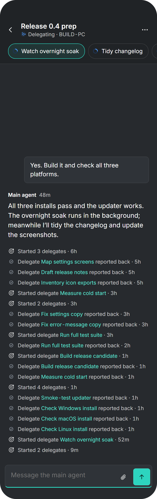
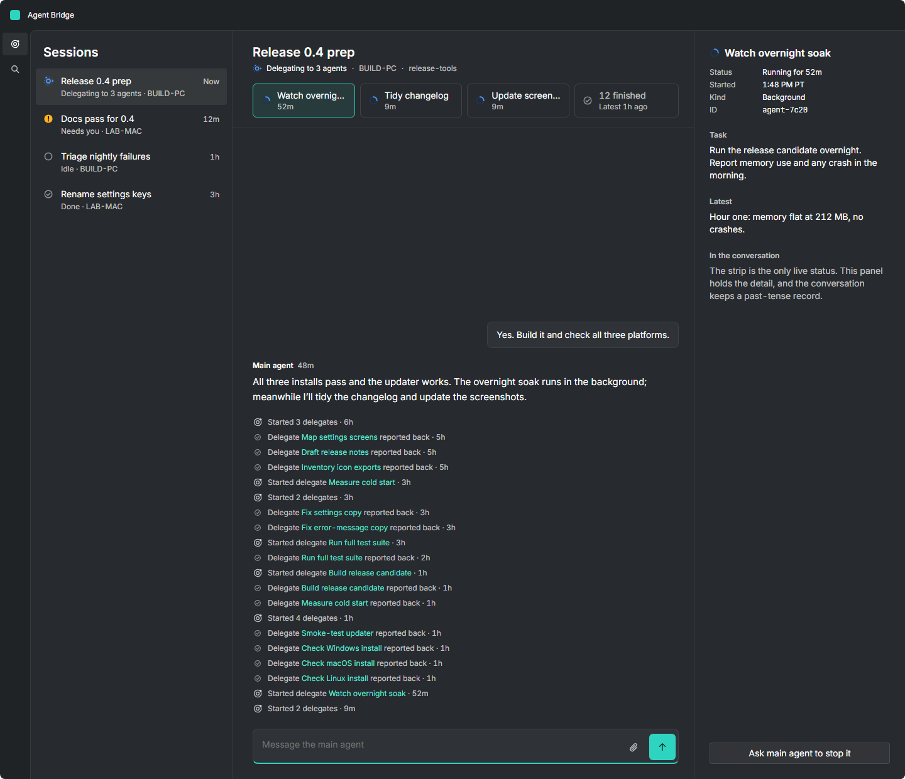
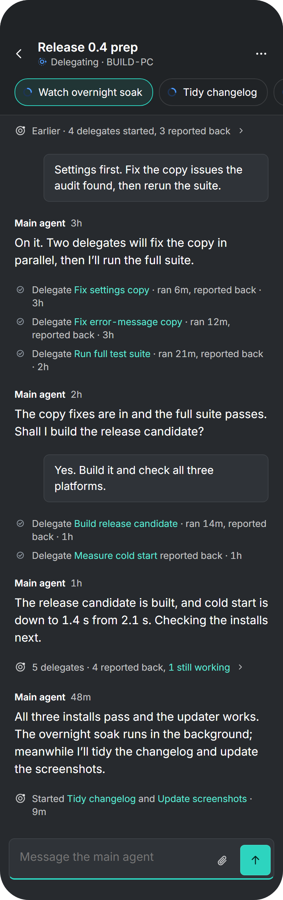
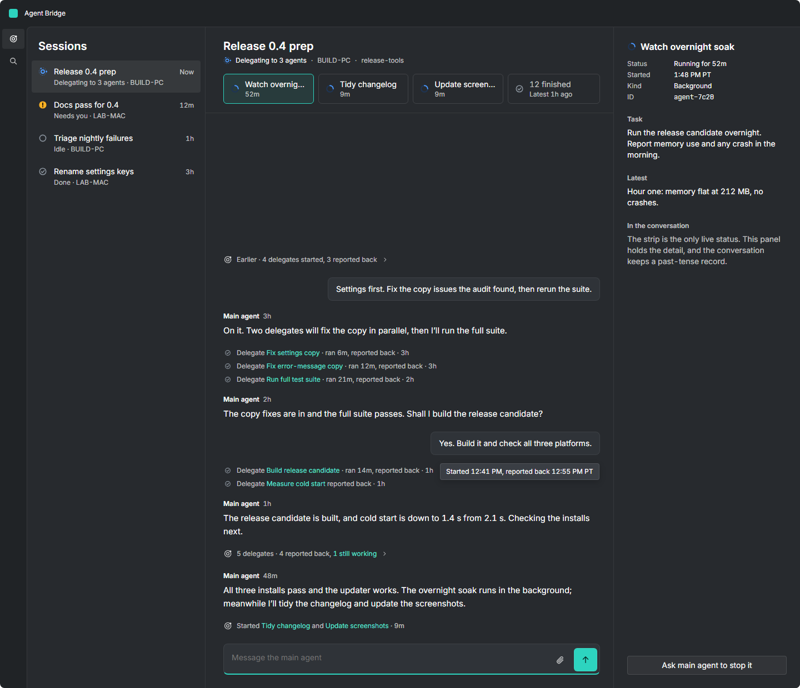
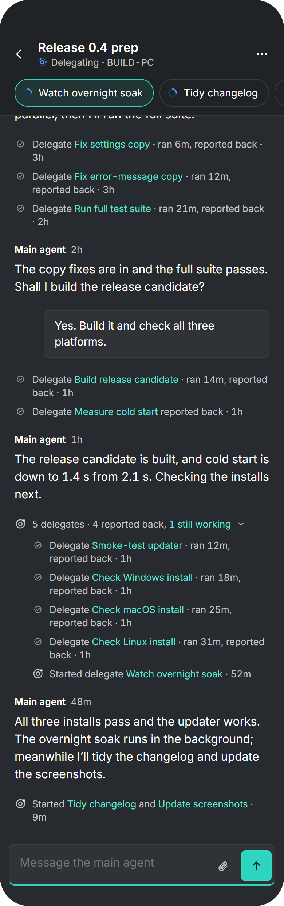
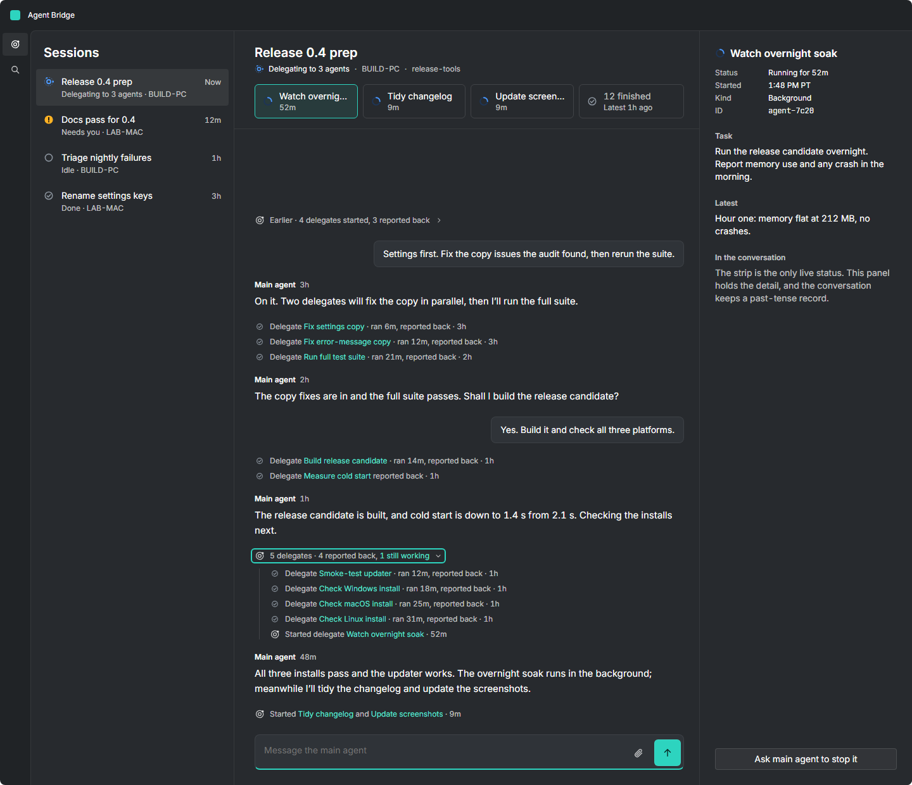
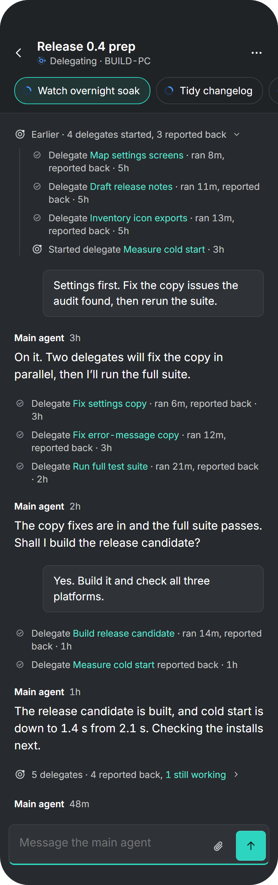
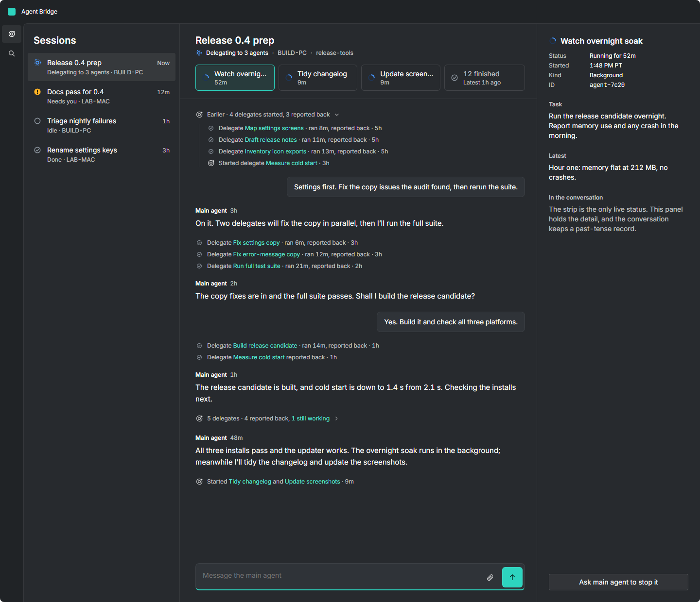
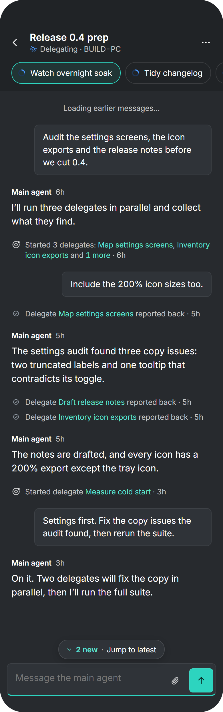
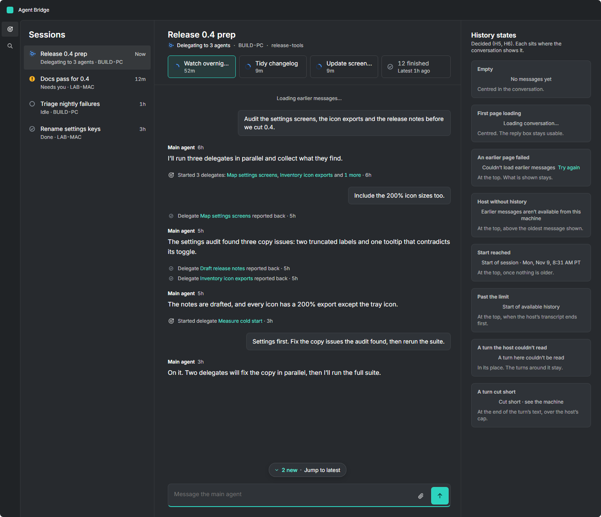

# Proposal #661: delegate events in the conversation, and history

> **D1–D4 decided 2026-11-04 08:40 PT.** The owner approved every recommendation on
> [#661](https://github.com/danswett/agent-bridge/issues/661), and they are in
> [ui.md §6.4](../ui.md#64-conversation) ("Delegate events") and subagents.md §6. **ui.md is
> the spec.** History's H0–H8 (#292) were **decided 2026-11-04** too, each as recommended
> (§3), and are in ui.md §6.4 ("History").

Issues: [#661](https://github.com/danswett/agent-bridge/issues/661),
[#176](https://github.com/danswett/agent-bridge/issues/176),
[#292](https://github.com/danswett/agent-bridge/issues/292); motion per
[#659](https://github.com/danswett/agent-bridge/issues/659).

The mock-ups are in [661-delegate-events/](661-delegate-events/), drawn from
`design/canvas/Proposal-661-*.dc.html` with
[tools/design-mockups](../../../tools/design-mockups/README.md):

```
node render.js ../../design/canvas ../../docs/design/proposals/661-delegate-events Proposal-661-
```

The session, people and machines are made up. It is 2:40 PM PT, six hours and 15 delegates into
a coordinator session, "Release 0.4 prep".

## 1. The problem

Every delegate event is appended under the latest reply, oldest first, so a busy coordinator's
reply ends in a column of 20 lines that span six hours and several messages. A line can't say
which turn it belonged to, and "Started 3 delegates" names nobody. Live status lives in the
strip already, so a line under the reply can read as live when it isn't.

## 2. Decided (D1–D4)

- **D1** Each event sits between messages by its time; a report-back sits just above the main
  agent turn it started.
- **D2** One line per delegate per gap: "Delegate *X* · ran 1m, reported back · 9m". A
  start-only line gains "reported back" in place, easing.
- **D3** Every delegate named ("Started *A* and *B*"; "Started 3 delegates: *A*, *B* and 1
  more"). More than 3 lines in a row fold into "5 delegates · 4 reported back, 1 still working
  ›", which expands in place and is remembered per session.
- **D4** Until history (#292), events older than the oldest message shown fold into "Earlier ·
  N delegates started, M reported back" at the top, never under the latest reply.
- **Framing:** the strip, tab or chips are the present tense and the only live status; lines are
  a past-tense record in meta style; the inspector holds the detail. The tooltip or accessible
  name gives the absolute Pacific time. A fold is one keyboard-expandable accessible item.

| | Phone | Desktop |
|---|---|---|
| Before (today) |  |  |
| After |  |  |
| Run fold expanded |  |  |
| Earlier expanded |  |  |

## 3. Decided: history (H0–H8, #292)

The rules are in ui.md §6.4 ("History"). The history boards show a session scrolled up while an
earlier page loads, with "2 new · Jump to latest"; the desktop board lists the H5 and H6 states
in place of the inspector.

| Phone | Desktop |
|---|---|
|  |  |

**Decided by the owner on 2026-11-04,** each as recommended. On #666 the decisions were
numbered H1–H9; the rule each one set is in brackets.

1. **Loading earlier (H2):** automatic near the top, with a "Load earlier messages" button for
   a keyboard, a screen reader and a retry.
2. **Where a session opens (H1):** at the latest message.
3. **Page size and the client's cap (H2, H6):** about 20 turns a page and 500 kept.
4. **Resolved questions (H4):** kept as far back as history goes.
5. **The pill's count (H3):** "2 new · Jump to latest".
6. **The start (H5):** a "Start of session · *date*" line.
7. **A turn (H0):** a prompt and everything until the next, scheduled and agent-sent prompts
   included.
8. **A question while reading back (H3a):** the pill says "Question · Jump to latest" and
   nothing scrolls.
9. **Search (H7):** no search within a session until #289, which searches every turn of every
   session.

H8 lists only what the design needs from the protocol: ordered turns with stable ids and times, a before-cursor with whether older turns remain, cut-short and unreadable flags, and live turns carrying the same ids. The wire format is #292's protocol owner's.

## 4. Boards

| Board | Dark | Light |
|---|---|---|
| Phone, before | [dark](661-delegate-events/proposal-661-phone-before.png) | [light](661-delegate-events/proposal-661-phone-before-light.png) |
| Phone, after | [dark](661-delegate-events/proposal-661-phone-after.png) | [light](661-delegate-events/proposal-661-phone-after-light.png) |
| Phone, run fold expanded | [dark](661-delegate-events/proposal-661-phone-expanded.png) | [light](661-delegate-events/proposal-661-phone-expanded-light.png) |
| Phone, Earlier expanded | [dark](661-delegate-events/proposal-661-phone-earlier.png) | [light](661-delegate-events/proposal-661-phone-earlier-light.png) |
| Phone, history | [dark](661-delegate-events/proposal-661-phone-history.png) | [light](661-delegate-events/proposal-661-phone-history-light.png) |
| Desktop, before | [dark](661-delegate-events/proposal-661-desktop-before.png) | [light](661-delegate-events/proposal-661-desktop-before-light.png) |
| Desktop, after | [dark](661-delegate-events/proposal-661-desktop-after.png) | [light](661-delegate-events/proposal-661-desktop-after-light.png) |
| Desktop, run fold expanded | [dark](661-delegate-events/proposal-661-desktop-expanded.png) | [light](661-delegate-events/proposal-661-desktop-expanded-light.png) |
| Desktop, Earlier expanded | [dark](661-delegate-events/proposal-661-desktop-earlier.png) | [light](661-delegate-events/proposal-661-desktop-earlier-light.png) |
| Desktop, history | [dark](661-delegate-events/proposal-661-desktop-history.png) | [light](661-delegate-events/proposal-661-desktop-history-light.png) |

`proposal-661-session.png` is the component itself at its defaults (phone, after, dark).
