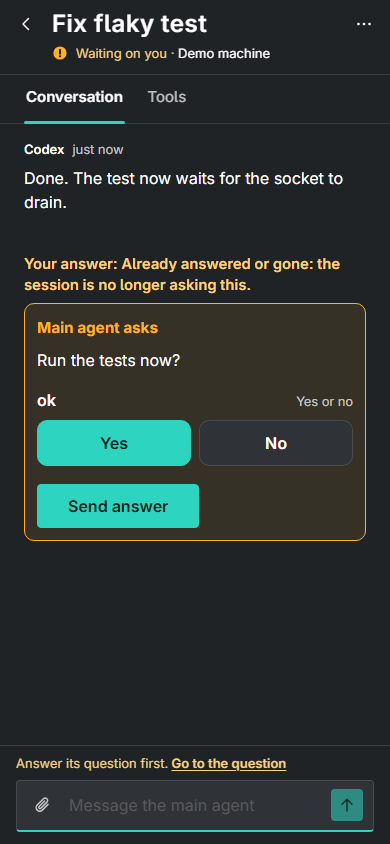
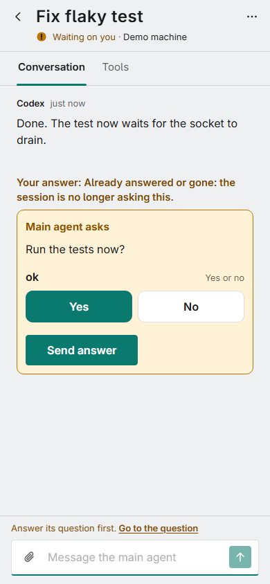

# Lines that outlive their cause: inventory for #1193

Inventory only. Nothing in this PR changes behaviour. Phase 2 (the fix) waits for the owner's go.

Issue: [#1193](https://github.com/danswett/agent-bridge/issues/1193). Related: #954 (a question
stays answerable after the host restarts), #1123 (a refused answer is a dead end), #467 (an
unconfirmed send), #617 (the receipt's words), #908 (reasons with fixed words).

Written 2026-11-07 (PT) from `origin/main` at `6606804e7`. Each PWA row was read in the code and, where
a capture is named, drawn by the product's own demo (`?demo=1`) at a phone's width, in dark and light.

## What the owner saw

The amber line "Your answer: Already answered or gone: the session is no longer asking this." sitting in
the conversation, above a later question. It is row **A2**: an answer was still on its way when the question
changed, the host then said `stale`, and the receipt for the old answer was drawn above the new question.




## How to read the table

- **Where**: the file and line that writes the words (`pwa/js/...`).
- **Tone**: `warn` (amber), `bad` (red), `progress`, or `ok`/neutral.
- **Clears today**: what actually removes the line. "Nothing" means no timer, no state change and no
  later event does; only a reload (the answer, reply, stop and launch services keep their entries in
  memory, so a reload starts clean) or the card going away.
- **Should clear**: when the cause stops being true, using the issue's own list: the question leaves the
  session list, the next turn starts, a retry succeeds, a refresh, time passes ("Try again in a moment"), a
  countdown ends.
- **Capture**: the PWA state, drawn in dark and light, in
  [`proposals/1193-stale-lines/`](proposals/1193-stale-lines/). `observed.json` there holds the words the page
  had 6 to 7 seconds after the cause went.

On `stale`: the host cannot tell a question the owner cancelled from one answered elsewhere or withdrawn by
the session (Connection). So this inventory treats `stale` as one neutral closed state, and "Should clear"
for it is "when the question leaves the session list", with no cause promised. The words are for Design.

## A. An answer to a question

The answer's outcome is drawn in three places: the form on the question's card, the receipt in the
conversation once the form has gone (`session-card.js`), and the Needs you lane. The words come from one place,
`OUTCOME_TEXT` and `describeAnswer` in `pwa/js/ui/question-view.js:159-206`. The receipt adds the prefix
"Your answer: " to every outcome but `delivered` (`session-card.js:1700`), so a refusal or a stale answer reads
as the person's own answer.

How a card decides between the form and the receipt (`session-card.js:1421-1470`): when the question goes
(`!q`) and the answer is on its way, failed, or ended in anything but busy or refused (`leaves`, line 394),
the **form stays in place** (`#leave`) with the line under it. When the answer ended busy or refused, or the
question was replaced by another, the form goes and the **receipt** takes its place. A receipt is dropped
only when a question is next drawn (`session-card.js:1469`), and only if it had already said its last word
at that moment.

| # | Line | Where | Tone | Clears today | Should clear | Capture |
|---|---|---|---|---|---|---|
| A1 | Already answered or gone: the session is no longer asking this. (the form of the gone question stays, options disabled) | `question-view.js:163`; kept by `session-card.js:1440` (`#leave`) | warn | Nothing, until the next question is drawn (then the receipt is made and dropped at once) or the card goes | The question leaves the session list: the form goes with it, or shows one neutral closed line that clears with the next turn | [dark](proposals/1193-stale-lines/stale-a1-answer-stale-dark.png) · [light](proposals/1193-stale-lines/stale-a1-answer-stale-light.png) |
| A2 | Your answer: Already answered or gone: the session is no longer asking this. (the owner's screenshot) | `question-view.js:163` + prefix `session-card.js:1700`; made by `#watchReceipt` (`session-card.js:1685`) | warn | Nothing: the receipt is only dropped by the next `#renderQuestion` that finds it final, and an unchanged question returns early (`session-card.js:1420`). It stayed over 7 s above the new question in the capture | The question leaves the session list (it already has: the line is about a question that is gone), or the next turn starts | [dark](proposals/1193-stale-lines/stale-a2-answer-stale-receipt-dark.png) · [light](proposals/1193-stale-lines/stale-a2-answer-stale-receipt-light.png) |
| A3 | Your answer: The machine refused this answer: *reason* | `question-view.js:165,199`; receipt via `#leave` → `resolve` (`session-card.js:1729-1751`) | bad | Nothing, until the next question is drawn | The question leaves the list: nothing to fix is left, so no red line | [dark](proposals/1193-stale-lines/stale-a3-answer-refused-gone-dark.png) · [light](proposals/1193-stale-lines/stale-a3-answer-refused-gone-light.png) |
| A4 | Your answer: Another answer to this session is being delivered. Try again in a moment. | `question-view.js:164`; same path as A3 | warn | Nothing, until the next question is drawn. Nothing can be tried again: the question is gone | The question leaves the list, or when the moment passes | [dark](proposals/1193-stale-lines/stale-a4-answer-busy-gone-dark.png) · [light](proposals/1193-stale-lines/stale-a4-answer-busy-gone-light.png) |
| A5 | Sent, but not confirmed. Check the conversation. *(reason)*; also the two stage forms (`typed`, `recorded`) | `question-view.js:162,168-171,202-204`; the form stays (`#leave`) | warn | Nothing, except a reconnect that re-asks a `typed`/`recorded` stage and gets `delivered` (`answer-service.js:#recheck`); otherwise until the next question | The next turn starts (the conversation then shows whether it went in), or a refresh finds it delivered | [dark](proposals/1193-stale-lines/stale-a5-answer-unconfirmed-dark.png) · [light](proposals/1193-stale-lines/stale-a5-answer-unconfirmed-light.png) |
| A6 | Couldn't send it: *reason*, with **Try again** (for a question that is gone) | `question-view.js:185-187`; the form stays (`#leave`) | bad | Nothing until a retry; the retry of a gone question comes back `stale` and becomes A1 | The question leaves the list: no Try again for it, no red line; a retry that succeeds | [dark](proposals/1193-stale-lines/stale-a6-answer-failed-gone-dark.png) · [light](proposals/1193-stale-lines/stale-a6-answer-failed-gone-light.png) |
| A7 | The question changed before you sent your answer. It was answered at the machine, or the agent moved on. What you typed is kept here. (and "This question can no longer be answered from here. What you typed is kept here.") | `session-card.js:1439,1782-1785` | warn (`role="alert"`) | Only the **Dismiss** button, or the card going. It stayed above the next question in the capture | Keep the text and the Dismiss, drop the amber tone, and let it go with the next turn | [dark](proposals/1193-stale-lines/stale-a7-question-changed-dark.png) · [light](proposals/1193-stale-lines/stale-a7-question-changed-light.png) |
| A8 | You answered · *value* | `question-view.js:161,191-197` | ok | Until the next question is drawn. By design (the receipt of an answer the person gave) | Fine as the one line a person's own answer leaves; clears with the next turn | [dark](proposals/1193-stale-lines/stale-a8-answer-delivered-dark.png) · [light](proposals/1193-stale-lines/stale-a8-answer-delivered-light.png) |
| A9 | The in-flight lines: Waiting for *machine* · it goes when *machine* is back; Still sending…; Sent · still waiting on *machine*; Passed to the agent · not picked up yet | `receipt.js:describeInFlight` (55-90); drawn in the form, the receipt and the lane | progress | The next state of the request, or the 9-minute give-up (`answer-service.js`), which ends in A5 | As today: each is true while it is true. Only the last state's line outlives it (A5) | none (needs a held clock) |
| A10 | The same lines in the **Needs you** lane (`.needs-status`) | `needs-you-view.js:147`, `LINGER_READ_MS` (22), `#lingers` (248) | as above | **5 s** after the question leaves (or at once if no answer was on its way); then the entry is dropped | Already right: the lane is the model for the card | none (not stale) |

Also checked, not stale: the validation line `.answer-error` clears on the next edit or send
(`question-view.js:591-597`); "Updating…" and the offline line follow the hold (`#show`, `setHeld`).

## B. A reply

One status line under the box (`.reply-status`). Its words are `OUTCOME_TEXT` and `describeReply` in
`pwa/js/ui/reply-view.js:42-90`. The service keeps the entry for the session until the next send, and
`#show` redraws the same line on every update of the session.

| # | Line | Where | Tone | Clears today | Should clear | Capture |
|---|---|---|---|---|---|---|
| R1 | Not sent: an answer or another reply to this session is being delivered. Try again in a moment. | `reply-view.js:46` | warn | Nothing. Send comes back after 2 s (`REPLY_BUSY_PAUSE_MS`); the line stays | When the moment passes (2 s), or on the next edit | [dark](proposals/1193-stale-lines/stale-r1-reply-busy-dark.png) · [light](proposals/1193-stale-lines/stale-r1-reply-busy-light.png) |
| R2 | Not sent: the session has ended. | `reply-view.js:45` | warn | Nothing, until the next send | The next turn, or a refresh; a person who types again is past it | [dark](proposals/1193-stale-lines/stale-r2-reply-stale-dark.png) · [light](proposals/1193-stale-lines/stale-r2-reply-stale-light.png) |
| R3 | Sent, but not confirmed. Check the conversation before sending it again. *(reason)* | `reply-view.js:44,82` | warn | Nothing, until the next send | The next turn starts (the conversation shows whether it went in) | [dark](proposals/1193-stale-lines/stale-r3-reply-unconfirmed-dark.png) · [light](proposals/1193-stale-lines/stale-r3-reply-unconfirmed-light.png) |
| R4 | The machine refused this reply: *reason* | `reply-view.js:47,81` | bad | Nothing, until the next send | The next edit of the box, or the next turn | none |
| R5 | Couldn't send it: *reason*, with Try again | `reply-view.js:75` | bad | A retry, an edit of the files (`#edited`), or the next send | A retry that succeeds, or a refresh | none |
| R6 | Cancelled. Nothing was sent to the session. | `reply-view.js:74` | warn | Nothing, until the next send | The next edit, or the next turn | none |

Checked, not stale: "The session is waiting for an answer to its question. Answer that first, then reply."
(`reply-view.js:246`) follows the question; `.reply-error` clears on the next edit.

## C. End session

One status line in Details (`.stop-status`). Words: `describeStop`, `pwa/js/ui/stop-view.js:27-61`. It is redrawn
from the service entry on every update of the session, which is kept until the next press.

| # | Line | Where | Tone | Clears today | Should clear | Capture |
|---|---|---|---|---|---|---|
| S1 | Not ended: an answer or reply to this session is being delivered, or it is already being ended. Try again in a moment. | `stop-view.js:55` | warn | Nothing. The button comes back after 2 s (`STOP_BUSY_PAUSE_MS`); the line stays | When the moment passes (2 s) | [dark](proposals/1193-stale-lines/stale-s1-stop-busy-dark.png) · [light](proposals/1193-stale-lines/stale-s1-stop-busy-light.png) |
| S2 | End session NOT confirmed: no second press within *N* s. The session is still running. | `stop-view.js:46-47` (`LAPSED_NOTE`) | warn | Nothing: the countdown (S-confirm, below) ends in it, and it stays until the next press | A countdown that ended is history: clears after a short time, or the next turn | [dark](proposals/1193-stale-lines/stale-s2-stop-lapsed-dark.png) · [light](proposals/1193-stale-lines/stale-s2-stop-lapsed-light.png) |
| S3 | This session had already ended. | `stop-view.js:53` | warn | Nothing until the next press. The card was still shown 6 s later in the capture | The session leaves the list (the card goes with it) | [dark](proposals/1193-stale-lines/stale-s3-stop-stale-dark.png) · [light](proposals/1193-stale-lines/stale-s3-stop-stale-light.png) |
| S4 | The machine refused to end this session: *reason*; Couldn't send it: *reason* (with Try again); Couldn't end the session… | `stop-view.js:39,57-59` | bad | Nothing until the next press | A retry that succeeds, or a refresh | none |
| S5 | Press End session again to end it: *why*. *N* s left. | `stop-view.js:49` | warn | The countdown (1 s ticks) | The countdown ends, and becomes S2 | none (needs the clock; seen in `stop.spec.mjs:91`) |
| S6 | Session ended. | `stop-view.js:51` | ok | Nothing, but the card goes | Already right | none |

## D. Launch

One status line under Launch (`.launch-status`) and one card per folder-trust question. The service keeps the last
launch of each machine, and the panel redraws it on every list from the machine (`launch-view.js:524`), until the
next launch. Words: `describeLaunch`, `launch-view.js:40-70`, and `describeTrust`, `launch-view.js:73-95`.

| # | Line | Where | Tone | Clears today | Should clear | Capture |
|---|---|---|---|---|---|---|
| L1 | Not launched: *reason* Try again in a moment. | `launch-view.js:64` | warn | Nothing, until the next launch from this page. The settings can change, the machine can stop being busy; the line stays | When the moment passes, or the machine's next list says it is not busy; on a change of the settings | [dark](proposals/1193-stale-lines/stale-l1-launch-busy-dark.png) · [light](proposals/1193-stale-lines/stale-l1-launch-busy-light.png) |
| L2 | Not launched: *reason* | `launch-view.js:66` | bad | Nothing, until the next launch | A refresh of the machine's choices, or a change of the settings the reason is about | [dark](proposals/1193-stale-lines/stale-l2-launch-refused-dark.png) · [light](proposals/1193-stale-lines/stale-l2-launch-refused-light.png) |
| L3 | Launched, but not confirmed: *reason* | `launch-view.js:60`; already turned into "Session started" if the card then shows up (`launch-view.js:865`) | warn | The card arriving, else nothing until the next launch | A refresh, or the session's card arriving (done only when its id is known) | [dark](proposals/1193-stale-lines/stale-l3-launch-unconfirmed-dark.png) · [light](proposals/1193-stale-lines/stale-l3-launch-unconfirmed-light.png) |
| L4 | Couldn't send it: *reason* (with Try again); Couldn't launch… | `launch-view.js:50,68` | bad | A retry; otherwise the next launch | A retry that succeeds, or a refresh | none |
| L5 | Session started. / Session brought over and started… | `launch-view.js:58` | ok | Nothing, until the next launch; the panel then jumps to the card | Fine; clears when the panel closes or on the next visit | none |
| L6 | Not launched: *what the form lacks* (pick a workspace, no agent installed, couldn't sign the request…) | `launch-view.js:577,589`, `#local` (757) | bad | The next redraw of the panel: any list from the machine, not the person fixing it | When the setting it is about changes | none (the demo always offers a workspace) |
| L7 | *Machine* is still finding its sessions. Try Launch again in a moment. | `launch-view.js:63` | progress | Nothing, until the next launch | When the moment passes, or the machine's list says discovery is done | none |
| L8 | Folder trust answers: Trusted. *X* started. / Not trusted. … / Not answered: *reason* / Couldn't send it… / Not confirmed… | `launch-view.js:73-95`, kept in `#trustAnswers` (`launch-view.js:136`, across machines picked) | ok, bad, warn | Nothing for the page's life: the answer is shown "after the machine stops listing the question" (comment above `#trustAnswers`, `launch-view.js:132-135`) | The machine stops listing the question: then one neutral closed line that clears with the next list | [dark](proposals/1193-stale-lines/stale-l4-trust-gone-dark.png) · [light](proposals/1193-stale-lines/stale-l4-trust-gone-light.png) |
| L9 | *Machine* no longer lists this question as waiting. (beside a not-answered line) | `launch-view.js:677` | warn | Nothing, while the answer entry exists | It is the cause being gone: one neutral line, clearing with the next list | same as L8 |

Checked, not stale: "Couldn't get the choices from *machine*: …" clears when the next load succeeds
(`launch-view.js:298,387`); "*Machine* is busy: …" and the held line follow the machine's list.

## E. Elsewhere in the PWA

| # | Line | Where | Tone | Clears today | Should clear | Capture |
|---|---|---|---|---|---|---|
| O1 | A machine's update note: *reason it refused*; It did not take it: *the machine could not be reached* (`.machine-error`, `role="alert"`) | `update.js:138-140`, drawn by `views.js:614` | bad | The next press, a forget, or a sign-out (`update.js:130,153,158`); not when the machine's update state moves on | The machine's next `update.state`, or a successful press | none |
| O2 | A machine's forget error | `forget.js:80`, drawn by `views.js:724` | bad | The next press, or when the machine leaves the offline list (`forget.js:93-97`) | Already right | none |
| O3 | Couldn't load the history: *error* | `session-card.js:1834` | warn | The next load (any update of the session while Tools shows, or showing Tools again) | Already right | none |

## What is not captured, and what is not verified

- A9, A10, R4-R6, S4-S6, L4-L7 and O1-O3 were read in the code, not drawn.
- "Nothing clears it" for A1-A8, R1-R3, S1-S3 and L1-L3 is shown by the code (no timer, no listener) and by
  the 6-7 s the captures waited after the cause had gone. It was not left running for longer.
- Reload clears every row above: the services hold their entries in memory only.
- iOS: not checked. The PWA is what runs there (the owner's screenshot is the PWA on an iPhone), so rows A-E apply
  as they are; the Safari-specific drawing was not captured.
- The demo's host replays the host's contract; the words were also checked against the strings in the C# tests.

## The Windows app, by the same words (not changed; Client Experience owns Windows)

The same strings, and the same placement, are in `src/`. How long each stays on Windows was not traced; the
receipt and the orphan note are built as in the PWA.

| Words | Windows |
|---|---|
| Already answered or gone: the session is no longer asking this. | `QuestionViewModel.cs:24`; asserted in `NeedsYouTests.cs:242`, `SelfTest.Progress.cs:187`, and `ToastTests.cs:844` (a toast answer comes back as an outcome toast with these words) |
| Another answer to this session is being delivered. Try again in a moment. / The machine refused this answer. / Sent, but not confirmed. Check the conversation. | `QuestionViewModel.cs:21-26,544`, `Receipt.cs:71` |
| Your answer: *…* | `SessionCardViewModel.cs:431` (prefix), `:251` (the room it keeps); the receipt's key `receiptKey` is set at `:357-360` |
| The question changed before you sent your answer. … What you typed is kept here. | `SessionCardViewModel.cs:357` |
| *…* The question changed since, so answer it again. (Windows only: a failed answer, once the question changed) | `QuestionViewModel.cs:530` |
| Not sent: the session has ended. / Not sent: an answer or another reply … Try again in a moment. | `ReplyViewModel.cs:45-46` |
| This session had already ended. / Not ended: … Try again in a moment. / End session NOT confirmed | `EndSessionViewModel.cs:13,132-133` (and `HaConnector.Stops.cs:13`) |
| Not launched: … Try again in a moment. / … is still finding its sessions. Try Launch again in a moment. | `LaunchViewModel.cs:820-821` |
| *Machine* no longer lists this question as waiting. | `LaunchViewModel.Trust.cs:178` |

## Reproducing the captures

From `pwa/` (after `npm ci`):

```
npx playwright test --config ../docs/design/proposals/1193-stale-lines/playwright.config.mjs
```

This writes `stale-<id>-dark.png` and `stale-<id>-light.png` (390 x 844, Chromium) and `observed.json` into
[`proposals/1193-stale-lines/`](proposals/1193-stale-lines/). It is not part of the PWA's suite or of CI.
