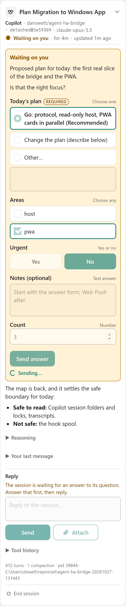
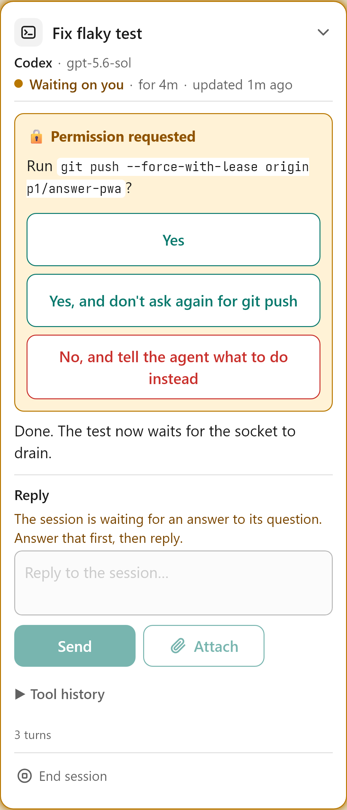

# Agent Bridge PWA

The phone client: your machines and their live agent sessions, end-to-end encrypted
through the relay. Plain ES modules and CSS, no framework, no build step, nothing from a
CDN: the page's Content-Security-Policy allows scripts and styles from this site only,
and network access to the relay only.

Published at <https://danswett.github.io/agent-bridge/app/> by `.github/workflows/pages.yml`.
Try it without a machine: [`?demo=1`](https://danswett.github.io/agent-bridge/app/?demo=1).

It shows sessions, their activity and their pending questions, answers those questions
(`session.answer`) and replies to sessions (`session.reply`), per
[docs/protocol/v1-sessions.md](../docs/protocol/v1-sessions.md). Attachments, launching and
notifications come next.

| Light | Dark | Answering | A permission request |
|---|---|---|---|
|  |  |  |  |

## Modules

| File | What it does |
|---|---|
| `js/main.js` | Boot and wiring: demo or live, sign-in, the views |
| `js/identity.js` | This device's P-256 key, generated non-extractable and kept in IndexedDB; its device id |
| `js/signin.js` | GitHub device flow through the relay; the stored account |
| `js/relay.js` | One relay WebSocket: hello, key proof, presence, routed frames. A send on a dead socket throws |
| `js/connection.js` | The relay over time: reconnect with backoff, at once on `visibilitychange`/`pageshow`/`online`; stop on a refused sign-in or a takeover by another window |
| `js/channels.js` | Noise_XX_P256 channels to hosts, as the initiator, with the peer's key checked against its id |
| `js/noise-p256.js` | Vendored copy of `spikes/s2-noise-interop/web/noise-p256.js` |
| `js/protocol.js` | Op and event names, and the tolerant reader: unknown fields dropped, unknown enum values read as the C# reader reads them |
| `js/host-client.js` | The sessions protocol over any transport: requests by `id`/`re`, events by `ev`, `seq` checking, the subscription snapshot |
| `js/host-session.js` | Which host is shown, and keeping a subscription to it across reconnects; remembers the last host; honours `?host=` |
| `js/sessions-store.js` | The live sessions, most recently updated first |
| `js/answers.js` | An answer as the form holds it, as the request sends it, and checked first: `checkAnswer` mirrors the C# `Answers.Check` case for case, with its wording |
| `js/answer-service.js` | Sending answers, one outcome each: a fresh request UUID per answer, resent with the **same** request after a lost response or a reconnect |
| `js/replies.js` | A reply checked before it goes: `checkReply` mirrors the C# `Replies.Check`, with its wording |
| `js/reply-service.js` | Sending replies: `answer-service.js` with `session.reply`, one reply on its way per session |
| `js/markdown.js` | Markdown to DOM without HTML (see below) |
| `js/ui/*` | Session cards, the question and its answer form, the reply box, machines list, fold state, relative times |
| `js/demo.js` | `?demo=1`: a simulated host speaking the real protocol to the real client, answering and replying included |
| `tools/build-site.mjs` | Assembles the site for Pages: `config.js` with the relay, CSP in the page, and `sw.js` stamped with a hash of everything served, so any change reaches an open app as an update (the app then offers Reload) |

### Connecting a host

```
connection.openChannel(hostDeviceId)        // channels.js: Noise through the relay
  -> new HostClient(channel, { store })     // host-client.js
  -> client.hello()                         // needs protocol 1 and "sessions.read"
  -> client.subscribe()                     // {revision, count}, then upserts, then sessions.synced
host frames -> Channel.onmessage -> HostClient -> SessionsStore -> SessionListView
```

`HostSession.select(deviceId)` does all of that and redoes it after every reconnect. A
host needs only to answer `hello` and `sessions.subscribe` and send `session.upsert`,
`session.remove` and `sessions.synced` event frames on the channel; `session.get` feeds
the tool history, `session.answer` (with `sessions.answer` in `hello`) takes answers, and
`session.reply` (with `sessions.reply`) takes replies.
`test/e2e/fixture-host.mjs` is a working example in about 150 lines.

The client resubscribes when `seq` skips, repeats or goes backwards, and replaces its
list with the snapshot when `sessions.synced` arrives; until then the previous list stays
on screen. Unknown events still count for `seq`.

### Answering

A question can be answered from the phone when the machine's `hello` lists
`sessions.answer` and the question is not `truncated`. Otherwise it is shown read-only
with "Answer at the machine", and why.

| Question | Controls | Sent when |
|---|---|---|
| One `choice` field | A button per option, "(Recommended)" ones first; "Other…" opens a text box if `allowOther` | The tap (Other: Send) |
| `approval` with one `choice` field | Big buttons, allow in green and deny in red | The tap |
| Any other form | Per field: `choice` radios (+ Other), `multi` checkboxes (+ Other), `boolean` Yes/No, `text` a textarea, `number` a numeric input; `default`s pre-filled | Send |
| No fields | A text box, answering with `text` | Send |

Before anything is sent the form is checked as the host will check it: `required`, option
values, Other not empty, 4 KiB of UTF-8 per free text (counted in bytes; a counter appears
near the limit) and 16 KiB per request. A problem is named and focus goes to its field.

While an answer is on its way the controls are disabled and it says so. If the response is
lost (a timeout, the channel or relay dropping) it is resent with the same `request` on
the next channel to that machine, so the host returns the first outcome and never types it
twice; after 9 minutes without an outcome (hosts remember requests for 10) it is reported
as unconfirmed rather than sent again. Outcomes:

| Outcome | Shown | Then |
|---|---|---|
| `delivered` | Delivered. The session has your answer. | The host's upsert takes the question away; the card keeps the line |
| `unconfirmed`, or one this app doesn't know | Sent, but not confirmed. Check at the machine. | Final; nothing offers to send it again |
| `stale` | Already answered or gone | Final |
| `busy` | Another answer is being delivered. Try again in a moment. | Send comes back after 2 s, as a new request |
| `refused` | The machine refused this answer: *reason* | The form can be changed and sent, as a new request |

If the question changes or goes while something typed hasn't been sent, the card says so
and keeps the text, read-only, to copy. A card that moves while its form is in use keeps
focus and the caret. On a desktop, everything is reachable by Tab in order, radios move
with the arrow keys, and Ctrl+Enter (Cmd+Enter) sends from a text box.

Demo mode answers as a host would (`window.agentBridgeDemo.script('busy', …)` scripts the
next outcomes), and asks a follow-up question a little after each answer.

### Replying

Each card has a reply box when the machine's `hello` lists `sessions.reply`: a prompt for
the session, typed into its input on the machine, whether it is idle or working. Enter is
a new line and Ctrl+Enter (Cmd+Enter) or Send sends; the host types line breaks as spaces,
and the box says so when there are any. Before it goes the reply is checked as the host
will check it: not blank, 16 KiB of UTF-8 at most (a counter appears near the limit), and
not starting with `/` or `!`, which the agent would run as a command on the machine.

While the session is asking a question the box is disabled and says to answer first: the
words would answer it. Anything typed stays.

One reply per session is on its way at a time, resent with the same `request` like an
answer. The words stay in the box until the session has them: a delivered reply takes out
what was sent (anything typed meanwhile stays), and every other outcome keeps them.

| Outcome | Shown | Then |
|---|---|---|
| `delivered` | Delivered. The session has your reply. | The session's upsert shows it as your last message |
| `unconfirmed`, or unknown | Sent, but not confirmed. Check at the machine before sending it again. | The words stay; sending them again is a new reply |
| `stale` | Not sent: the session has ended. | |
| `busy` | Not sent: an answer or another reply is being delivered. | Send comes back after 2 s |
| `refused` | The machine refused this reply: *reason* (a question pending, an agent it can't reply to yet) | |

A host waits up to a minute for a working session to take a reply, so the request waits
90 s for its response before it counts as lost. Demo mode replies as a host would
(`window.agentBridgeDemo.scriptReplies(…)`), only to Copilot sessions.

### Markdown

Agent text is rendered by `js/markdown.js`, written for this app rather than vendored.
The common pairing, a Markdown library plus DOMPurify, produces an HTML string and then
parses it into the page, so safety depends on the sanitizer matching every parser quirk.
Here no string is ever parsed as HTML: the parser emits a small tree from a fixed tag
list, the DOM is built with `createElement` and text nodes, every tag and link is checked
again while building, and links keep only `http:`, `https:` and `mailto:` (absolute).
Images become links and are never loaded. It covers what agents write: paragraphs (line
breaks kept), headings, emphasis, code, fenced code, nested and task lists, quotes, rules,
GitHub tables and links. It is linear on hostile input (tested at 16 KiB).

## Tests

```
npm ci
node --test "test/unit/*.test.mjs"       # protocol client, tolerant reader, Markdown
npx playwright install chromium webkit
dotnet build ../spikes/s4-relay/src/S4.DevStack -c Release   # for test/e2e
npx playwright test                       # UI (demo mode) and E2E, Chromium and WebKit
node test/screenshots.mjs                 # docs/*.png, WebKit at iPhone size
```

Locally, if the public registry is blocked:
`npm install --no-save --no-package-lock --registry https://packagefeedproxy.microsoft.io/npm/`.

Every Playwright test serves the output of `tools/build-site.mjs` under
`/agent-bridge/app/`, so the published CSP is in force and a violation fails the test.
`PWA_TEST_PORT` (8790) and `PWA_E2E_PORT` (8800) move the servers' ports, for a machine
running another checkout's tests at the same time.

* `test/answer.spec.mjs`, in demo mode at a phone's size: answering every field type and
  kind, defaults, required fields, the byte limit, every outcome, a resend after a lost
  response (typed once), a question changing or going while being answered, a card moving
  while in use, 44 px targets, and the keyboard.
* `test/reply.spec.mjs`, in demo mode: a reply delivered as one line and taken out of the
  box (keeping what was typed meanwhile), every outcome keeping the words, a resend after a
  lost response (typed once), the box held while a question is pending, the checks before
  sending, 44 px targets, Ctrl/Cmd+Enter, and no box for a machine without `sessions.reply`.
* `test/ui.spec.mjs`, in demo mode: every field type and status from the worked example,
  glow per status, the delegating state (idle with `background` work), reduced motion,
  Markdown, an XSS payload in every text field, unknown
  status/agent/fields/events, a `seq` gap, reordering and removal, fold persistence and
  auto-unfold, truncation notes, tool history via `session.get`, the worker's scope.
* `test/e2e/e2e.spec.mjs`, through the spike dev stack's real relay with a fake GitHub:
  sign-in, key proof, presence, a Noise channel to a Node fixture host, the snapshot, live
  upserts and removes, `session.get`, recovery after the socket drops (a session that
  ended meanwhile disappears), returning to the last host, `?host=` links, the S4
  demo host reported as not supporting sessions, and answering: delivered, an answer in
  flight when the socket drops resent with the same request and typed once, and the
  fixture host's own validation (stale and refused); and replying, the same way, with a
  reply refused while the session asks a question.

Not covered end to end: the C# Bridge Host (it is not wired yet; the fixture host speaks
the same contract), the live relay and GitHub, real phones, and Web Push.
