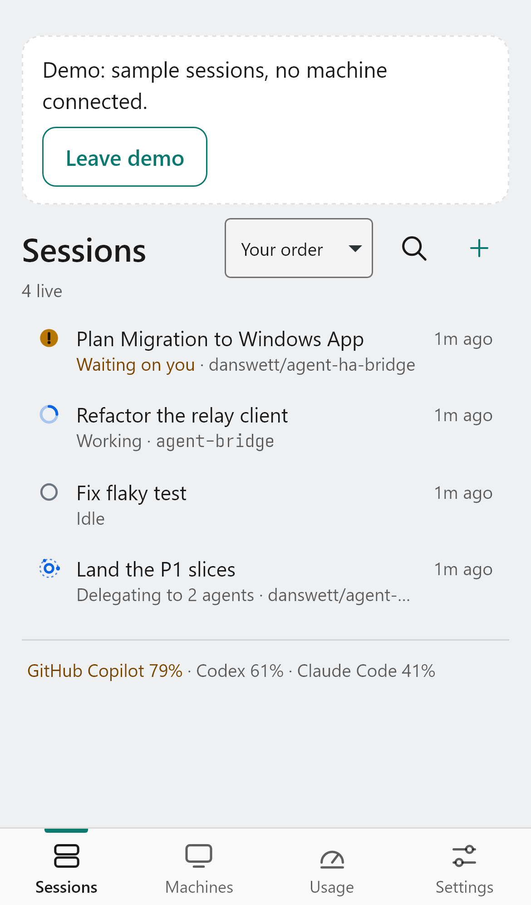
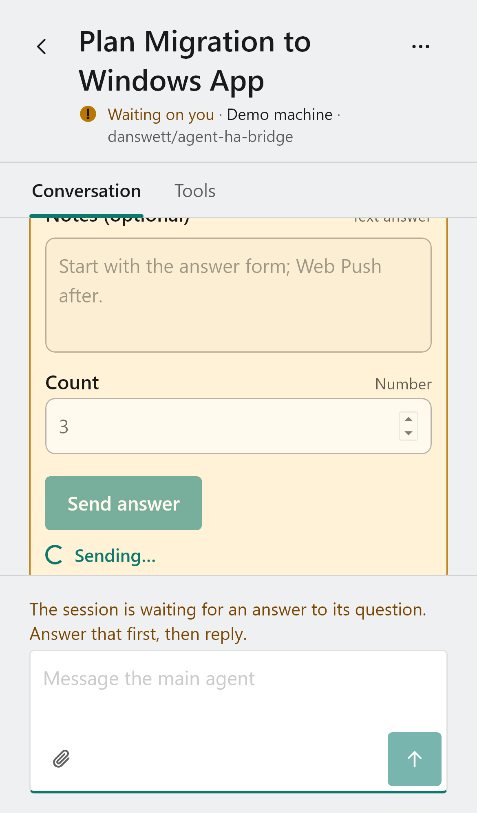
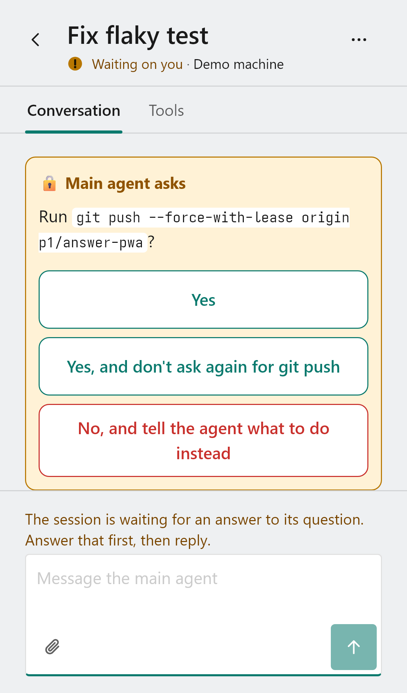
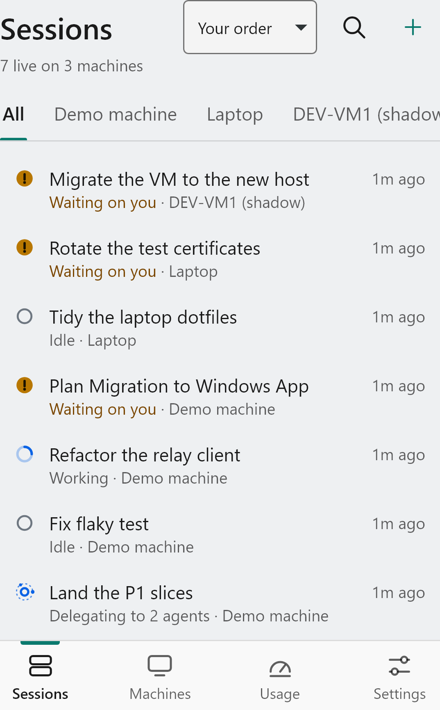
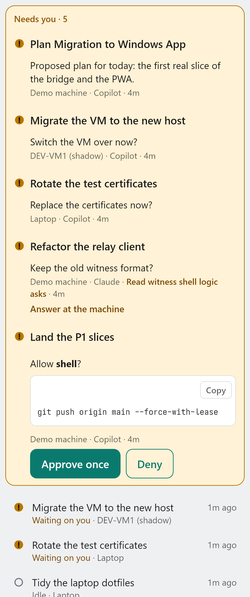

# The Slipgates web app (PWA)

The phone client: your machines and their live agent sessions, end-to-end encrypted
through the relay. Plain ES modules and CSS, no framework, no build step, nothing from a
CDN: the page's Content-Security-Policy allows scripts and styles from this site only,
and network access to the relay only.

Published at <https://app.slipgates.com/> (live since 2026-11-07, #393) by `.github/workflows/pages.yml`, with the
repository variable `PAGES_APP_AT_ROOT` set to `true`: the app is the site's root, and the old
`danswett.github.io/agent-bridge/app/` address sends visitors there. The tests serve the app at `/`, as it is there.
The move, what people who installed the old address have to do again (their sign-in and saved settings do not
carry over), what was checked on the live address and what was not, and the rollback:
[docs/app-domain.md](../docs/app-domain.md). `node test/live-origin-check.mjs` repeats the read-only browser checks
against the live address.
Try it without a machine: [`?demo=1`](https://app.slipgates.com/?demo=1).

It shows sessions, their activity and their pending questions, answers those questions
(`session.answer`), replies to sessions (`session.reply`) with files and images
(`attachment.*`), ends them (`session.stop`), starts and resumes them (`session.launch`),
notifies the phone when a session asks or finishes, even with the app closed (Web Push),
shows each agent's usage and each machine's status, for one machine or for every machine at
once, and shows each machine's updates with Check, Install and Check all, per
[docs/protocol/v1-sessions.md](../docs/protocol/v1-sessions.md),
[v1-launch.md](../docs/protocol/v1-launch.md), [v1-usage.md](../docs/protocol/v1-usage.md) and
[v1-update.md](../docs/protocol/v1-update.md).
Larger files come next.

The app was called Agent Bridge before it became Slipgates (#538). The app shows the new name
as soon as it updates, and an installed app takes the new name and icon too, except that an
installed iPhone/iPad app keeps its old icon until you choose to reinstall it, with the name
Agent Bridge under it. Apple gives a Home Screen app no way to change either, and reinstalling
makes it a new device, signed in and approved again, so keeping it is fine.

| Light | Dark | Answering | A permission request | All machines | Needs you |
|---|---|---|---|---|---|
|  |  |  |  |  |  |

## Modules

| File | What it does |
|---|---|
| `js/main.js` | Boot and wiring: demo or live, sign-in, the views |
| `js/brand.js` | The product's name (`BRAND.name`, and `BRAND.shortName` for under a home-screen icon) and the sentences that say it, the one source for every place the app shows it (#538). The name is the brand token, re-exported from `design/brand.js`, which `tools/design-gen` generates from `design/tokens.json` `brand` ([brand.md](../docs/design/brand.md)). Storage keys, IndexedDB and cache names, the worker's scope and messages, push subscriptions and the relay protocol are identifiers, not the brand, and never come from it (#541) |
| `js/identity.js` | This device's P-256 key, generated non-extractable and kept in IndexedDB; its device id |
| `js/signin.js` | GitHub device flow through the relay; the stored account |
| `js/relay.js` | One relay WebSocket: hello, key proof, presence (with the account's offline machines, `known`), routed frames, `forget`. A send on a dead socket throws |
| `js/connection.js` | The relay over time: reconnect with jittered backoff (`js/backoff.js`, tested in `test/unit/backoff.test.mjs`), at once on `visibilitychange`/`pageshow`/`online`; stop on a refused sign-in; a window another window has replaced (close 4009) takes the connection back once on its own and says nothing, in sight at once or out of sight when next in front, and stops for good, saying so with Use here, if it is replaced again within `REPLACED_GUARD_MS` (60 s) of that take-back (#1218). Out of sight for 15 s (`QUIET_AFTER_MS`), it rests (#610): the socket closes, and with it every channel, subscription and look, and Web Push says what needs the person meanwhile; never while an answer, reply, stop, launch, request or blob is on its way. Back in sight it connects at once, and each machine shown is subscribed again and held as confirming until its list is whole (#427), as after a drop. Unlike a drop, a rest is not trouble: each machine whose list was current shows as confirming, not reconnecting, and its questions stay in the app badge, though not in the lane, until its list is whole, its channel fails or the relay does not come back (`js/host-session.js` `rested`). A message sent on a channel with nothing at all back for 5 s (`PROBE_AFTER_MS`) has the relay probed (`Relay.probe`: a one-byte frame to this device itself, which the relay routes back); with no answer in 3 s (`PROBE_TIMEOUT_MS`) the socket is given up as half-open and another opened at once, and what was on its way goes again with its same request (#1128). Each drop is logged with its cause and the time since the last frame |
| `js/channels.js` | Noise_XX_P256 channels to hosts, as the initiator, with the peer's key checked against its id |
| `js/noise-p256.js` | Vendored copy of `spikes/s2-noise-interop/web/noise-p256.js` |
| `js/protocol.js` | Op and event names, and the tolerant reader: unknown fields dropped, unknown enum values read as the C# reader reads them |
| `js/host-client.js` | The sessions protocol over any transport: requests by `id`/`re`, events by `ev`, `seq` checking, the subscription snapshot, and resuming it where the host offers `sessions.patch` |
| `js/history.js` | `session.history` (#292, [v1-history.md](../docs/protocol/v1-history.md)): the request's check and the page's tolerant reader (turns, parts, `start`, and the `missing`, `stale` and `unavailable` results), strict where the spec is |
| `js/history-store.js` | A session's turns, held by turn id from history pages and live `activity` (`activity.turn`, `responseTurn`): the newest page, earlier pages by the host's cursor, a stale cursor asked again without it, about 500 turns kept, a host without `sessions.history` unavailable. Data only, with `watch`; the session card draws the turns before its latest exchange from it, read-only (`js/ui/history-view.js`), and opens at the latest (#1285) |
| `js/session-patch.js` | `session.patch` read and applied to the session as last received, exactly as `SessionPatches.Apply` in C# |
| `js/host-session.js` | Which machines are shown, one or all (`ALL`), each with a channel and store of its own kept across reconnects; remembers the choice; honours `?host=`; `route(hostId)`, the only way to a machine's channel for what a card sends |
| `js/sessions-store.js` | The live sessions, most recently updated first (the Most recent sort); a removed session goes with its change, for the Ended group |
| `js/session-order.js` | The list's order, kept on this device (#164): Your order (new sessions at the top once, then never moved by the host), pins, Most recent and Machine sorts, the Ended group, and which rows have news since last open. Blocked storage falls back to Most recent |
| `js/status.js` | What a session says about itself: [ui.md](../docs/design/ui.md) §2.2's rules, as its glyph, its words, the colour role of the words, and the glyph's accessible name (§9). Rules 1-6 first match wins, 8 refining 4, and 7 (an agent driving) as an overlay. Pure, and tested rule by rule in `test/unit/status.test.mjs` |
| `js/attribution.js` | Who said what (#176): the main agent's own response and reasoning, never a delegate's (`activity.source` and `activity.own`, [v1-sessions.md](../docs/protocol/v1-sessions.md) Activity), and the delegates as a card lists them: running first, then idle, each under its parent, with its glyph and words, and the finished folded apart; the delegates one started, at any depth; the conversation's "Started N delegates" and "Delegate *name* reported back" lines; the words "Ask main agent to stop it" puts in the reply box; and a host's background counts where it lists none. Pure, and tested in `test/unit/attribution.test.mjs` |
| `js/prompt-origin.js` | A prompt the person didn't type (#489, [ui.md](../docs/design/ui.md) §6.4): who sent it (`activity.userMessageFrom`: a schedule, an agent, or other; absent is the person), its label line's words and spoken name, its label cleaned and cut to 64 bytes, its hidden characters as escapes, and `PromptMemory`, which folds a schedule's repeat ("same as last time") and dates a prompt by its turn. Pure, and tested in `test/unit/prompt-origin.test.mjs` |
| `js/needs-you.js` | The Needs you lane (#165): one entry per pending question across the machines shown, oldest first; what each says (title, machine, agent, age, first line or an approval's whole prompt, a delegate by name) and offers (Approve once and Deny, open the session, or answer at the machine); and the app badge with its count |
| `js/answers.js` | An answer as the form holds it, as the request sends it, and checked first: `checkAnswer` mirrors the C# `Answers.Check` case for case, with its wording |
| `js/answer-service.js` | Sending answers, one outcome each: a fresh request UUID per answer, resent with the **same** request after a lost response or a reconnect; how far each has got where the machine says (`sessions.progress`: received, typed, queued) |
| `js/ui/receipt.js` | The receipt of a reply or an answer (#600, #617): its words at each stage, the quiet window, the dwell, the stalls and what a screen reader hears. The timing is tested on a mocked clock in `test/unit/receipt.test.mjs` |
| `js/timing.js` | Timing marks for each answer and reply (#600), kept on this device only: tap, each send, each progress stage and the outcome as `performance` marks and measures, with the machine's own `timings` beside them |
| `js/replies.js` | A reply checked before it goes: `checkReply` mirrors the C# `Replies.Check`, with its wording |
| `js/reply-service.js` | Sending replies: `answer-service.js` with `session.reply`, one reply on its way per session, its files sent first |
| `js/attachments.js` | A file or image for a reply: named, size-checked (a large image is redrawn smaller), hashed, and sent in chunks from where the machine has got to |
| `js/stop-service.js` | Ending sessions: `answer-service.js` with `session.stop`, one press on its way per session, the second press carrying the first's token |
| `js/launch.js` | Launching: the tolerant readers of `launch.options` and a launch's result (an unknown outcome is `unconfirmed`), and `checkLaunch`, which mirrors the C# `LaunchProtocol.Check` with its wording; folder-trust questions and their answers (`launch.trust`) |
| `js/transfer.js` | Signed commands: bringing a session from another machine (the account's other machines' sessions, `sessions.transfer.serve`, and the command this device signs for the one a session is on, [v1-transfer.md](../docs/protocol/v1-transfer.md)), and answering a folder-trust question (`launch.trust:trust` or `:quit`, for the machine asking it), held to the host's by shared test vectors |
| `js/launch-options-cache.js` | The last `launch.options` each machine gave, kept in memory with when it came and why the last ask failed. Online machines are asked one at a time in the background, so the Start a session form opens at once with its choices and their age. A machine is asked again only on a data event (it reconnects, the panel is opened, or a launch is refused or fails), never on a timer (#1511). The host still checks every launch itself (#1527) |
| `js/launch-service.js` | Starting sessions: `answer-service.js` with `session.launch`, one launch on its way per machine, resent with the same request until it has an outcome |
| `js/launch-follow.js` | A launch followed after its outcome, as the app's `LaunchViewModel` does (#891, #896): a busy machine listed again once its busy can have ended (its question's two minutes and a second, or 2 min 1 s with none named) or when a session registers on it, one listing at a time; and a launch the machine could not confirm said to have started when its session registers, by the host's rule (not a Copilot's, which registers before it is ready), or when its folder-trust question is trusted here. One whose outcome named no session (a Codex's) is not followed, as which session is its own can't be told here, until the host names it (#983) |
| `js/push.js` | Notifications: whether this device can have them, turning them on (permission, then a push subscription with the relay's VAPID key) and off, and registering with each machine opened (`push.subscribe`) |
| `js/reading.js` | The session being read (#1190): tells each machine what the page shows (`sessions.focus`, through `HostSession.setFocus`) when it is in sight or hidden or the open session changes, and closes that session's shown notices when it opens, when the page comes back to it, and a second after each change to it while it is in sight, and again about 4 s and 10 s after the last (the host's question push comes 2 s after the question, a finished turn's 3 s after the turn; the passes stop when the page hides, the session shown changes, or it is stopped) (all of them but a question's other than the one its card shows: `openQuestion`, also said in `sessions.focus`). Signing out stops it, taking off every listener. It also times the person's input (passive listeners, a timestamp write each) for `sessions.focus`'s `idleMs`: said again on the first input after a spell without any and about each minute while input goes on, never while idle or hidden. The service worker is untouched: it still shows every push |
| `js/usage.js` | Agent usage: the tolerant reader, merging every machine's reports into one row per allowance (a reading beats a failure, then the freshest wins), and the card's words: colours at 75% and 90%, pace, resets, ages |
| `js/fleet.js` | Each machine's status line (`3 sessions · 0.1.0 (dev)`), usage, updates and who can sign Copilot in there (`signin.devices`, where offered): each machine shown on its own channel (`usage.subscribe`, `update.subscribe`), every other online machine by a short channel (`hello`, `usage.get`, `update.get`) every five minutes while the app is in front (#610; it was every minute), every ten seconds while an update there is under way; a machine shown asked for its hello again on its channel when it says it changed (`hello.changed`), else every minute; `call` sends a press to a machine on whichever |
| `js/update.js` | A machine's updates ([v1-update.md](../docs/protocol/v1-update.md), #51): the tolerant reader, the row's words (what the machine's app is doing, how the last update ended), and `UpdateControl`, Check and Install with a request of their own each, a refusal shown on the row, and Check all; and Update now (#1159): whether it can be pressed or why not, what its confirmation lists (`nowSheet`), the signed press with what was shown (`accept`), a confirm outcome shown again, results worded from their `code` (never the machine's text), and "Restarting to update…" for 90 s once the machine has gone |
| `js/ui/update-now-sheet.js` | Update now's confirmation (#1159): a modal dialog listing the busy sessions by name and state, with Cancel (focused first) and Update now; Escape cancels and nothing is sent |
| `js/signin-devices.js` | Who can sign Copilot in on a machine (#972, ui.md §6.6): the tolerant reader of `signin.devices` (only a roster read lists anyone; a kind not a person's is dropped) and the row's words, in Creative's, with this device named and more than three folded. Read-only: nothing here adds or removes a device |
| `js/diagnostics.js` | A machine's diagnostics ([v1-diagnostics.md](../docs/protocol/v1-diagnostics.md), #802): the reader of `diagnostics.get`'s snapshot, its plain-text report, and `DiagnoseControl`, Diagnose on a machine's row, never asked of a host that does not offer it, and Copy only after the person says they reviewed it |
| `js/forget.js` | Forgetting an offline machine ([roster.md](../docs/protocol/roster.md)): two presses, the first arming for 5 seconds; an arm goes with a machine that comes back; the relay's refusals in words |
| `sw.js` | The service worker: each release in a cache of its own, filled whole when its worker installs and served from there without asking the network, so a warm start waits on nothing and works offline (#609); anything else (the demo's chunk) stale-while-revalidate; and showing pushes (`push`) and opening the app at them (`notificationclick`). A release changes only as a whole: the browser checks `sw.js` on each start and the app on each return to the front, a new worker fills its own cache before it takes over, and the app then offers Reload, so old and new modules never mix (#26). The release before is kept for a page still open on it |
| `js/release-watch.js` | New releases that keep failing to install (#650): a release installs whole or not at all, so one file missing from a deploy leaves the app on the release it has, and the browser tries again quietly at every start. After three failures in a row (counted in `localStorage` under the release in control, from the worker's record, so a release that installs with no page open clears them too), an app running a release it has says so, with Try again (a reload, the browser's next try); a release that installs clears it |
| `js/platform.js` | The platform layer (#168, [ui.md](../docs/design/ui.md) §7): `windows`, `macos`, `ios`, `ipados`, `android`, `chromeos`, `linux` or `unknown`, from Chromium's client hints or else the user agent (a Mac with a touch screen is an iPad), and whether the app is installed (`display-mode: standalone`, or iOS's `navigator.standalone`), set once on `<html data-platform data-standalone>`. The hints (⌘↩ and ⌘K on Apple's, Ctrl+Enter and Ctrl+K elsewhere; either modifier works everywhere), the safe areas (`viewport-fit=cover` kept only when installed on iOS or iPadOS, where the app bar, the bottom navigation or rail and the reply box keep clear of the notch and the home indicator; elsewhere the browser keeps the page out of them), no double-tap wait there, and its edge swipe back. `unknown` is Windows; nothing depends on detection being right |
| `js/key-check.js`, `js/ui/key-check-view.js` | Settings > Keyboard check (#1209): while on, each keydown anywhere in the app is listed (key, code, Option, Control, Command, Shift, what had focus by what it is, never its words, and whether the app used the key), with how the page is open (installed or browser, and the raw `display-mode`). It only watches; a key that could be typing in a text box (a character, an input method's or a dead key, AltGr's or Option's) is listed without the key or its code; nothing is saved or sent, and Copy results puts the list on the clipboard. The words are tested in `test/unit/key-check.test.mjs` |
| `js/markdown.js` | Markdown to DOM without HTML (see below) |
| `js/hidden-text.js` | Text not on screen as it runs (#165, #220): the hidden and right-to-left characters the Needs you lane refuses, and the `\uXXXX` escapes code and approvals draw them as (the app's `HiddenText`) |
| `js/auth-state.js` | An agent that needs sign-in, whose turn ended on an error, or that has stopped answering (#800): every protocol name for them in one place (`Session.attention`, `hello.machine.signIn`, `sessions.signin` and its `signin.*` ops and events, as Connection's contract on #800 has them), the github.com allowlist, the user code's shape, and agent text cut short and refused when token-shaped (the app's `AuthState`) |
| `js/details-rows.js` | A session's Details rows ([ui.md](../docs/design/ui.md) §6.2, #1087), pure: the words and their order the table both clients share sets ([session-details.json](../docs/design/session-details.json)), which `test/unit/details-rows.test.mjs` checks them against, as the Windows app's `DetailsTableTests` does; `session-card.js` draws what it returns |
| `js/ui/sign-in-view.js` | The sign-in banners (#800): one per machine, agent and account, naming the sessions held up as links in its line, with Sign in, and focused from a sign-in push's link (#969); and the sheet that press opens, with the code from this device's own `signin.code`, Copy and Open |
| `js/ui/needs-you-view.js` | Needs you on screen, above the list and apart from it, its entries kept in place across redraws |
| `js/ui/sessions-page.js` | The sessions on screen and everything sent from them, in the live app and the demo alike: each session's answers, replies, files, End session and the launch panel to the machine it is for; which session is chosen (from the address, kept across a resize) and which panes show; the heading, count, empty state and a line per machine that can't be reached |
| `js/ui/delegates-view.js` | A session's delegates (ui.md §6.3): the strip under the header at three panes and a phone's chip row (an item per delegate the main agent started, "N finished" folded); the Delegates tab's list (a row per delegate under its parent: glyph, name, how long or finished, its latest line); and the delegate opened from any of them, in the inspector or pushed in the tab: Status, Model, Kind and ID, its Task, Latest and Reasoning, its Tools, the delegates it started, and "Ask main agent to stop it", which fills the reply box and sends nothing. Its own words come from `session.get` with `agent`, while it is on screen. Nothing in it replies to or stops a delegate |
| `js/ui/glyph.js` | The status glyphs at 12, 14, 16, 20 and 24 px and the design icons, drawn from the generated sprite with `<use>`: the role colour from `data-glyph`, the driven diamond over it, and the moving part (`glyph-spin`, `glyph-orbit`) in an HTML box of its own, which `app.css` turns on the compositor (#610, #505: an SVG child turned on the main thread, a style recalculation and a layout every frame) and reduced motion stops. Each glyph is a `<span>` of layers, each an `<svg>` of the 16 grid |
| `js/ui/ticker.js` | The clocks ("2m ago", "last seen") tick only while the page is in sight, and catch up once as it comes back (#610) |
| `js/ui/motion.js` | Motion ([ui.md](../docs/design/ui.md) §5.3, #232): the catalogue's motions that answer a change (push and pop, the inspector, a tab, a disclosure, a row arriving or leaving, a glyph changing, the activity dot, the selection pill, a menu, an acknowledgement, a banner, a reorder, the Needs you lane's mark and outcome, watched from outside the lane), each timed by its generated `--ab-motion-*` token, which reduced motion makes instant or a short cross-fade. Nothing is made untappable while it moves. What leaves is a copy, built node by node (text stays text, every HTML element a plain div or span, no id, class, link, control or script) and drawn with only the computed properties that draw it, clipped to what showed of it, in a closed shadow root that nothing can find or tap. `app.css` draws the rest: a press's release (only while `data-press="released"`), and the disclosure chevron |
| `js/ui/collapse-header.js` | A phone's session header collapsing on scroll ([ui.md](../docs/design/ui.md) §6.2, #631), below 760 px only (from there up it holds no listener and leaves no style behind). `Fold` is the pure state machine (the 32 px down and 64 px up hysteresis with its restart on a change of direction, the header riding the scroll one for one near the top, overscroll clamped; `test/unit/collapse-header.test.mjs`). `CollapsingHeader` reads only the person's scrolling (a scroll the app makes to a question, or content growing below, leaves the header as it was), sets `--ty`, `--covered` and `--head-h` on the view, expands the header for focus coming into it and keeps focused content clear of it after a resize or rotation. The `collapse` motion is timed by its generated `--ab-motion-collapse-*` tokens, a cross-fade under reduced motion |
| `js/ui/shell.js` | The shell ([ui.md](../docs/design/ui.md) §7, #179): the 56 px web app bar (mark and name, search, machines online, account) and a rail on a desktop; the page's title row and a bottom navigation bar with a Bridge indicator on a phone. Each page is a route in the hash (`#/sessions`, `#/machines`, `#/launch`, `#/usage`, `#/settings`), so a reload stays on it and the browser's back goes between them. Ctrl/Cmd+K focuses search, which narrows the sessions list |
| `js/ui/*` | The sessions page's panes (#179, ui.md §5.2): each session's two-line row and its view (header, conversation, reply box, and the inspector's Details and Tools; `session-card.js`), facts joined by separators that never start a line and paths cut in the middle (`meta.js`), the row menu (Move up, Move down, Pin), the question and its answer form, the reply box, End session, the Start a session panel (agent-ha-bridge's launch card, without its 255-character prompt), machines list (offline machines after the online ones, with when each was last seen and Forget, each row two lines: name and state, then at most two facts; #213), the machine tabs over the sessions, the usage page, relative times |
| `js/demo.js` | `?demo=1`, and loaded only then (a dynamic import, so a chunk of its own the live app never fetches): a simulated host speaking the real protocol to the real client, answering, replying, ending and launching sessions and usage included; `?machines=2` adds a second machine, Laptop, and `?machines=3` a read-only shadow, DEV-VM1 (shadow), behind a simulated relay (`DemoConnection`); `?updates=1` a machine whose app found a release, and installs it when asked (`?updateStep=<ms>` per step), and with it `?updateNow=1` one that offers Update now, its sessions busy as a host counts them (`?restartMs=<ms>` for how long a machine that left for one reads "Restarting to update…"); `?delegates=1` a session whose delegates are working, the main agent's words apart from theirs |
| `tools/build-site.mjs` | Assembles the site for Pages: `config.js` with the relay, CSP in the page, the scripts bundled and minified by esbuild into `bundle/` (an entry and the chunks it imports, named by their content's hash; the page preloads the chunks), the bundle listed in `sw.js` for the worker to keep, and `sw.js` stamped with a hash of everything served, so any change reaches an open app as an update (the app then offers Reload). `js/` is copied beside the bundle as it is, the source layout the tests import modules from; the page never loads it. Needs `npm ci` (esbuild). It refuses to build a site that lacks any file `sw.js` keeps, since no release could install from it. Pages runs it without install scripts (`npm ci --ignore-scripts`) in a job that holds no token to publish with; a second job deploys what it made |
| `tools/brand.mjs` | Writes `js/brand.js`'s name into what can't import it: the page's title, home-screen title, app-bar and navigation labels and each `<span data-brand>`, the manifest's `name` and `short_name`, and `sw.js`'s title for a push without one. `--check` (run by `test/unit/brand.test.mjs`) fails while any of them differs, so renaming is an edit to `design/tokens.json` `brand`, a run of `node tools/design-gen/generate.mjs`, then `node tools/brand.mjs` |
| `design/tokens.css`, `design/sprite.svg` | Generated by `tools/design-gen` from `/design` ([design/README.md](../design/README.md)); never edit them. The colour roles and surfaces as `--ab-*` custom properties (light, dark and forced colours), the glyphs and icons as symbols, and `@font-face` for Slipgates Sans and Slipgates Mono, whose WOFF2s and licences (licensed separately under SIL OFL 1.1, not this project's AGPL) `tools/build-site.mjs` copies from `/design/fonts` into the site's `design/fonts/`. `app.css` takes every colour from them |
| `icon.svg`, `icons/*.png` | The app icon (ui.md §7, [brand.md](../docs/design/brand.md) §6), generated by `tools/design-gen` too: the favicon and the manifest's `any` icons (the Windows tile), its maskable icons at 192 and 512, its `monochrome` icons at 192 and 512 (the maskable icon's mark alone, white on transparency, for Android's themed icons), and the 180 px `apple-touch-icon`. The offline shell holds them all. Notifications show `icons/icon-192.png`, with `icons/badge-96.png` as the badge Android draws in the status bar (the native 24 px mark, as the Android client's `ic_stat_slipgates`) |

### Connecting a host

```
connection.openChannel(hostDeviceId)        // channels.js: Noise through the relay
  -> new HostClient(channel, { store })     // host-client.js
  -> client.hello()                         // needs protocol 1 and "sessions.read"
  -> client.subscribe()                     // {revision, count}, then upserts, then sessions.synced
host frames -> Channel.onmessage -> HostClient -> SessionsStore -> SessionListView
```

`HostSession.select(deviceId)` does all of that and redoes it after every reconnect;
`HostSession.select(ALL)` does it for every online machine, each with its own channel and
store (see [Every machine at once](#every-machine-at-once)). A
host needs only to answer `hello` and `sessions.subscribe` and send `session.upsert`,
`session.remove` and `sessions.synced` event frames on the channel; `session.get` feeds
the tool history, `session.answer` (with `sessions.answer` in `hello`) takes answers, and
`session.reply` (with `sessions.reply`) takes replies, with `attachment.*` (with
`sessions.attach`) for their files; `launch.options` and `session.launch` (with
`sessions.launch`) start sessions, and with `sessions.transfer` bring one from another machine,
signed by this device. A launched agent asking whether to trust its folder is shown in the Start
a session panel in full (agent, the whole folder path, the repository root it applies to, the
agent's own warning); with `launch.trust` and where the machine allows it (`answerable`), Trust
and Quit answer it with `launch.trust.answer` and a command this device signs for that choice.
Otherwise it says to answer at the machine, and how to allow it there (or approve this device).
A machine that does not take launches now (read-only, agent-ha-bridge) still shows a waiting
question, read-only. It is asked for one again when it reconnects, and on updates at most every
30 seconds. With every machine shown it is offered only when no machine takes launches, and then
its panel stays while it offers others. An answer that may have been typed is never offered again from here, and a
resend the machine refuses (its command expired) reads as not confirmed. A launch not confirmed whose
session then registers (or whose question is trusted here) reads as started, its first message cleared
if unchanged and its card opened only while Launch shows that machine. One whose outcome named no session
is not followed (#983), and a start whose session isn't known says to open it from the list. A busy
machine is listed again once its busy can have ended, or when a session registers there (#896).
`test/e2e/fixture-host.mjs` is a working example in about 150 lines.

The client resubscribes when `seq` skips, repeats or goes backwards, and replaces its
list with the snapshot when `sessions.synced` arrives; until then the previous list stays
on screen. Unknown events still count for `seq`.

### Every machine at once

As the Windows app's **All machines**, the machine tabs over the sessions (and the **Machines**
page) list **All** first once more than one machine is online, and show every online machine's
sessions in one list. It is what the app shows when nothing has been chosen; picking one
machine shows that one alone, as before; and the choice, one machine or All, is remembered on
the device. A notification's link (`?host=`) shows its machine among the others when All was
chosen, and alone otherwise, or when its machine turns out to be offline; either way what is
remembered stays as picked. A machine chosen that is away keeps its tab, marked offline. The
app bar says how many machines are online ("3 machines").

* **The list.** Every machine's sessions together, in your order (`js/session-order.js`,
  #164): a session goes to the top once, when first seen, and then moves only when you
  move it; Most recent sorts them as the app used to, most recently updated first (ties by
  session id, then machine). Each row names its machine on its second line; the heading reads
  "Sessions on all machines" and the count "7 live on 3 machines". With one machine online,
  All shows it as that machine. A session chosen (`#/sessions/<machine>/<session>`), and its
  place in the order, are remembered by machine and session.
* **One machine at a time, still.** Each machine has its own channel, store, hello, retries
  and read-only state. A machine that can't be reached, is still connecting or does not
  support sessions gets a line of its own above the cards ("Couldn't reach Laptop: the
  handshake timed out. Trying again."), its cards stay while it reconnects, and the others
  carry on. "No live sessions on any of your machines." shows only once every machine online
  has said what it has.
* **A machine that drops off for a moment (#269, ui.md §2.2, §6.1 "A machine away", §6.6).** A
  machine that leaves presence (a host restart, an update, a network blip) keeps its rows, in
  their places, as it last sent them, and its tab, marked offline; its rows show the failed
  glyph and "Offline · last seen 2m ago" (line 2 "Offline · *machine*"). One still in presence
  whose channel is down or not yet open, or back in presence before its channel is, reads
  "Reconnecting…". Either way its rows are stale, and stay so on a new channel until that
  channel's first snapshot is whole. Nothing on them can be answered, approved or denied,
  replied to, given files, ended, or launched or resumed on: the controls are disabled (the
  launch panel says why), `HostSession.route()` is null for it, and every send goes through that
  one gate: the answer, reply, stop and launch services refuse anything new for it (`accepts`).
  Its questions leave Needs you and the app badge, and its notifications are closed only
  against its new whole list. Its actions come back only once its next snapshot is whole
  (`sessions.synced`), for the sessions and questions that snapshot still has, and anything
  sent before the drop and waiting to be resent goes only then, with the same request id, for
  the host to check against the live question. A session that ended meanwhile goes to Ended; a
  question that ended goes without being answerable. Selection, your order, pins and the
  address are kept. After 15 minutes away (`OFFLINE_KEEP_MS`) its rows go, and the Machines
  page still lists it, offline; forgetting it, signing out or another account takes them at
  once.
* **What a card sends goes to its own machine.** Answers, replies, files (through the
  channel, or through the relay's blob store for that machine), End session and launches are
  each given for one machine and go only through `HostSession.route(hostId)`, that machine's
  open channel; one waiting for a machine that is away is resent to that machine when it is
  back (once its new snapshot is whole), and never to a session of the same id on another. What a card offers comes from its
  own machine's hello, so a read-only shadow such as "DSWETT-DEV-VM1 (shadow)" shows its
  sessions read-only, saying why, beside machines that take answers.
* **Connections.** A machine is connected to only while it is shown: one channel per
  machine, at most three handshakes under way at once (one for a machine no longer shown is
  given up at once, and the host told), each machine retried on its own after
  a failure (5 s, doubling to a minute) and reopened a second after its channel closes. A
  relay drop keeps every machine's cards and reopens them all when it is back. Machines not
  shown are looked at by `fleet.js`'s short channel every five minutes; with All there
  are none. Ten machines are ten channels, well inside the relay's per-account bounds (32
  devices, 200 frames a second a socket).
* **Starting a session.** With All, the launch panel asks which machine to launch on,
  listing the machines that can (`sessions.launch`), as the app's launch page does. It starts
  from the machine last launched on or picked there, remembered on the device.
* **Notifications** are as before: each machine opened registers this device. With All, that
  is every machine shown, each on its own, so one slow or failing machine holds up no other.

### Needs you

Above the list, **Needs you · N** has an entry for each pending question on the machines
shown, the oldest first: the session's title, the question's first line (an approval's whole
prompt, when it fits), the machine (with every machine shown), the agent and how long it has
waited. A delegate's question says who asks, by the delegate's name. The lane refers to
sessions and never moves their rows. An entry leaves when its question does.

* **An approval** answerable from here has **Approve once** and **Deny** in the entry, under
  its whole prompt (at most 600 characters and 12 lines), drawn as the card draws it with code
  literal: Approve once allows all of it, so all of it is on screen. They are the card's own
  buttons: the same request, the same progress shown in the entry and on the card, and the
  same outcomes (a refused or busy answer can be given again, stale and unconfirmed are
  final). A longer approval (an edit's diff, a long command), one with a table, one not shaped
  as a host writes a permission (a fence in its words, words after its command or its opening
  fence, a link, whose words hide where it goes, or a character drawn other than where it runs,
  such as a bidi control, a zero-width space, a variation selector or a blank-looking space (U+00A0, U+2800, #546), or right-to-left letters, which reorder what is
  drawn around them; a hidden character the entry's line shows as an escape like `\u202E`), or one from Codex (whose command can reach the machine cut short)
  opens its session instead.
* **A form**, or a question this machine won't take from the phone, opens its session (the
  title), where the card says what it asks.
* **A prompt marked `answerAtMachine`** says "Answer at the machine", with nothing to press.
  Only `answerAtMachineReason: "shape"` adds "This kind of question can only be answered at
  the machine." after "Answer at the machine · *machine*", in Needs you's text colour.
  Both lines are accessible text, not a live region. Missing or unknown reasons retain the
  current single line. Row status and attention do not change.

The lane's count is the app's badge on the Home Screen or taskbar, where the browser has the
Badging API (`navigator.setAppBadge`), and nothing where it hasn't.

### Answering

A question can be answered from the phone when the machine's `hello` lists
`sessions.answer` and the question is neither `truncated` nor `answerAtMachine`. Otherwise
it is shown read-only with "Answer at the machine", and why. A prompt marked
`answerAtMachine` (a Claude permission prompt, say) shows only what it asks,
the card reads "Waiting on you · answer at the machine", and the reply box is held until it is answered
there. A Copilot permission prompt held that way on a machine whose `hello` lists
`sessions.answer` but not `sessions.approve` says approving from the phone is turned off
there. Otherwise a Copilot permission prompt shows what it would allow in full, with
Approve once and Deny.

| Question | Controls | Sent when |
|---|---|---|
| One `choice` field | A button per option, "(Recommended)" ones first; "Other…" opens a text box if `allowOther` | The tap (Other: Send) |
| `approval` with one `choice` field | Big buttons, allow in green and deny in red | The tap |
| Any other form | Per field: `choice` radios (+ Other), `multi` checkboxes (+ Other), `boolean` Yes/No, `text` a textarea, `number` a numeric input; `default`s pre-filled | Send |
| No fields | A text box, answering with `text` | Send |

Before anything is sent the form is checked as the host will check it: `required`, option
values, Other not empty, 4 KiB of UTF-8 per free text (counted in bytes; a counter appears
near the limit) and 16 KiB per request. A problem is named and focus goes to its field.

While an answer is on its way the controls are disabled. Where it has got is the receipt
(`js/ui/receipt.js`; ui.md §5.3, §6.5 and §9 as the owner decided them on #617, "quiet unless
something's wrong"). A machine whose `hello` lists `sessions.progress` is asked for it
(`"progress": true`, [v1-sessions.md](../docs/protocol/v1-sessions.md); left off a request that
fits its limit only without it), and says how far it has got: sent once it has it, passed to
the agent once the keys have gone, up next for a reply into a working session. A stage only
moves forward, across resends. The normal path shows nothing but the ring on the control that
sent (Send, the option tapped, or Approve once or Deny in Needs you); its stages are heard, not
seen ("Sending reply", "Reply sent", "Reply passed to the agent", "Reply up next, after the
agent's current step"). Delivered, that ring turns to the `check` icon for about a second
(`sendCheckHoldMs`) and back to the control's own glyph, and a confirmed answer's card resolves
to "You answered · *value*" in text2: a tap's option, free text's first line with its runs of
white space as one, cut at a word break within 40 characters, or nothing for a form of several
fields. A machine from before progress is heard as sending until its outcome, and never as sent.
The ring and the check sit in a slot each control keeps for them at rest, so they never cover a
label or a badge and the control never resizes. A host takes a question away as it types the
answer, before its result: the question stays, its ring on the option that went, until the
outcome; delivered, it shows the check and then resolves; not confirmed, stale or failed, it stays
as it went (that option pressed at full opacity, the rest disabled, the line saying why), since a
host types into a prompt once; busy or refused resolve to the receipt at once.

A line of words appears only for an exception: "Still sending…" after 3 s with nothing heard
(and for a resend), "Sent · still waiting on *machine*" after 5 s, "Passed to the agent · not
picked up yet" after 10 s (Up next never stalls), "· still being delivered" after the stage a
resend met the first copy at, "Waiting for *machine* · it goes when *machine* is back" (the ring
still, in Send's ink at full opacity), and any outcome but delivered, in today's words. It goes when the next stage or the
outcome makes it untrue. Nothing is shown or heard for the first 400 ms; after that a screen
reader hears the furthest stage reached, prefixed "Reply" or "Answer", at most one a second (the
later of two), and the outcome at once; a failure (refused, failed) is said assertively, on the
page's alert line and only there (ui.md §9.1 A6), and a file being read is said once as it starts. The thresholds are `ReceiptTiming`. All of it is kept
by request, so the form, Needs you and the card's receipt after the question has gone share one
timing and say each change once between them, in a view of the request that is on screen, or
else on the page's own live line (a session's card while another is open, a receipt gone with
its question, a reply box moved on to the next reply), never lost and never on a line showing
another request. A request still on its way when every view of it goes (its session ended, its
card taken away) is followed to its outcome on the page's line, at its own pace and for 10 minutes
at most (past the 9-minute give-up); a sign-out takes everything still to be said with it, so
nothing is spoken on the sign-in screen. In the view that sent it, a delivered answer's line stays
empty while its check holds, then reads You answered. A Needs you entry whose question the machine clears before
confirming its answer stays, ring on and nothing to press, apart from the count, until the
outcome has shown: a check for its second, any other outcome for 5 s, and never past 9 minutes.
With Other… open, an option tapped instead has the ring and Send answer none. From Send the line keeps the room the longest outcome needs (two lines in a
box under 640 px wide, one above), empty unless it has something to say, until the box is typed
in again, so nothing moves the box; a Needs you entry keeps its line's room (two lines on a
phone) in every state. If the response is
lost (a timeout, the channel or relay dropping) it is resent with the same `request` on
the next channel to that machine, so the host returns the first outcome and never types it
twice; after 9 minutes without an outcome (hosts remember requests for 10) it is reported
as unconfirmed rather than sent again. Outcomes:

| Outcome | Shown | Then |
|---|---|---|
| `delivered` | The check on the control that sent it for about a second, then You answered · *value* | The host's upsert takes the question away; the card keeps the line |
| `unconfirmed`, or one this app doesn't know | Sent, but not confirmed. Check the conversation. | Final; nothing offers to send it again. Once its question has left the session's list the card keeps the question as it was asked, with *Your answer: Sent, but not confirmed…* in neutral words |
| `unconfirmed`, stage `typed` | Typed into the prompt, but not confirmed as submitted. Check the conversation. | The same, but on a reconnect the same request is sent once more, which the host answers from the session's record without typing: delivered if it was submitted since (#467), and then it reads You answered |
| `unconfirmed`, stage `recorded` | The session recorded something for this question, but not confirmed as this answer. Check the conversation. The reason says what it recorded, or the error. | As `typed` |
| `stale`, with no reason code | Already answered or gone, while the question is still listed | Once the question has left the list: the question as it was asked, kept in the conversation, with **Question closed** in neutral words (no cause: the host cannot tell a question the agent withdrew from one answered elsewhere) |
| `stale`, code `formReset` | Not delivered: the form could not take your answer at the machine. The words typed stay, and Try again sends them as a new request while the question is listed | Once the question has left the list: the same line, neutral, with what was typed in a read-only box with Copy |
| `busy` | Another answer is being delivered. Try again in a moment. | Send comes back after 2 s, as a new request. Once the question has left the list: **Question closed** |
| `refused` | The machine refused this answer: *reason* | The form can be changed and sent, as a new request. Once the question has left the list: **Question closed** |
| `failed` (could not send), with Try again | Couldn't send it: *reason* | Once the question has left the list: **Question closed**, with nothing to try again |

A closed question stays in the conversation, through the next question and the next turn, up
to 20 a card. Only the words of an answer the person gave (in flight, or that may have gone in)
say *Your answer:*. The rule for every line that outlives its cause is in
[`docs/design/ui.md` §7](../docs/design/ui.md).

If the question changes or goes while something typed hasn't been sent, the card says so
and keeps the text, read-only, to copy, in a neutral note with Dismiss. It stays through the next turn and goes on Dismiss, or once that text is sent. A card that moves while its form is in use keeps
focus and the caret. On a desktop, everything is reachable by Tab in order, radios move
with the arrow keys, and Ctrl+Enter (Cmd+Enter) sends from a text box.

Demo mode answers as a host would (`window.agentBridgeDemo.script('busy', …)` scripts the
next outcomes), and asks a follow-up question a little after each answer.

### Replying

Each session has a reply box, at the foot of its conversation, when the machine's `hello` lists `sessions.reply`: a prompt for
the session, typed into its input on the machine, whether it is idle or working. Enter is
a new line and Ctrl+Enter (Cmd+Enter) or Send sends; the host types line breaks as spaces,
and the box says so when there are any. Before it goes the reply is checked as the host
will check it: not blank, 16 KiB of UTF-8 at most (a counter appears near the limit), and
not starting with `/` or `!`, which the agent would run as a command on the machine.

While the session is asking a question the box is disabled and says to answer first: the
words would answer it. Anything typed stays.

One reply per session is on its way at a time, resent with the same `request` like an
answer, and shows how far it has got like one (Sent, Passed to the agent, Up next) where the
machine says.
The words stay in the box until the session has them: a delivered reply takes out
what was sent (anything typed meanwhile stays), and every other outcome keeps them.

| Outcome | Shown | Then |
|---|---|---|
| `delivered` | Send's check for about a second; no line | The session's upsert shows it as your last message |
| `unconfirmed`, or unknown | Sent, but not confirmed. Check the conversation before sending it again. | The words stay; sending them again is a new reply. The line goes when the session's next turn starts |
| `stale` | Not sent: the session has ended. | The line goes with the next edit of the box, or the next turn |
| `busy` | Not sent: an answer or another reply is being delivered. | Send comes back after 2 s, and the line goes with it |
| `refused` | The machine refused this reply: *reason* (a question pending, an agent it can't reply to yet) | The line goes with the next edit of the box, or the next turn |

A host waits up to a minute for a working session to take a reply, so the request waits
90 s for its response before it counts as lost. Demo mode replies as a host would
(`window.agentBridgeDemo.scriptReplies(…)`), only to Copilot sessions.

### Timing marks

Each answer and reply keeps marks on this device (`js/timing.js`, #600), so where the time
went can be read without a debugger: the tap, each send once the channel has taken it (a resend
is `sent 2`; one the channel refused is none), each progress
stage and the outcome, as `performance` measures from the tap named
`agent-bridge reply 1a2b3c4d typed` (the request's first 8 hex digits, as the host's log
names it), with the machine's own `timings` from the result (ms since it received the request:
`typed`, `recorded`, `confirmed`). The last 50 are in `agentBridge.timings()` (in the demo,
`agentBridgeDemo.timings()`), and each outcome has a line on the console's verbose level.
None of it is ever sent anywhere.

### Turn timing

`js/turn-clock.js` (#1600) times what the person waits for: from sending a reply to the session
settling (it was `working`, and is no longer). Only `{ app: 'PWA', ms }` is kept, in the page
(`TurnClock.recent()`); no text, machine or session id is ever in a record. A second send before the turn settles keeps
the first start, and a turn open for over an hour is dropped. It is not wired in yet: that needs the send
path and the sessions page, and the relay call lands after the relay's aggregate store (#1599). It runs in the page that sent the reply; if the page closes, turns
in flight are lost and nothing else, because no state lives on any machine.

Demo mode plays a machine with progress: `?progress=0` one from before it,
`?confirmDelay=<ms>` the wait between typing and the outcome (to see Passed to the agent), and
`host.holdBefore('typing' | 'result')` with `releaseBefore` hold a delivery at a stage for a test.

### Attachments

Where the machine's `hello` lists `sessions.attach`, files and images go with a reply:
pasted into the box (a screenshot, or a file copied from a file manager), dropped on it, or
picked with **Attach**, which on an iPhone offers the photo library, the camera and Files.
Each shows as a chip, with a thumbnail for an image, and can be removed until it is sent.
A reply can be files alone, up to 10 of them.

Files up to 256 KiB go in the channel. A larger one, up to 100 MiB (or less, if the relay says
so), goes as it is through the relay's **blob store** where the machine lists
`sessions.attach.blob` and the relay's `ready` has `blobs` ([blobs.md](../docs/protocol/blobs.md)):
`js/blobs.js` seals it in the browser with a fresh key (AES-256-GCM records, WebCrypto),
uploads it straight to Azure Storage on the URL the relay gives (an XHR, for upload
progress), then names it to the machine with its key inside the channel and waits while the
machine fetches and checks it. The status line says "Uploading the attachment… N%", then
"The machine is receiving…", and **Cancel** stops the upload or the wait (the reply is then
not sent, the files stay, and Send starts over); a blob already sealed for a reply that did
not go is reused, so only what is missing is sent again. A relay refusal (over the daily
allowance, too many at once, too large) says so in words and keeps the file in the box.
Small files keep to the channel even then: nothing is stored, and nothing extra can fail.

Without the blob store, each file is at most 256 KiB. An image over that, as most phone
photos and screenshots are, is redrawn as a JPEG at most 2048 px on a side, then smaller,
until it fits, and its chip says it was made smaller. Anything else over it is refused with
its size. An image the browser can't decode (HEIC outside Safari) can't be shrunk, so it
goes only if it already fits. Demo mode has a pretend blob store
(`window.agentBridgeDemo.blobs`; `?blobs=0` turns it off, `?blobMax=<bytes>` and
`?uploadDelay=<ms>` shape it).

On **Send** the files go first, one 11 KiB chunk at a time, each from where the machine has
got to, with the percentage shown; then the reply names them. A resend after a reconnect
sends only what the machine is missing, and nothing for files it already has whole. A file
the machine turns down fails the reply with its reason and **Try again**, which goes once a
file is added or removed, so that Send sends what the box shows. A delivered reply
takes its files out of the box; any other outcome keeps them, and after `unconfirmed` they
are sent afresh if sent again, since the machine has let them go. The machine types each as
`@<path>` ahead of the words, as agent-ha-bridge does. Demo mode keeps the files as a host
would (`window.agentBridgeDemo.host.attachments`).

### Ending a session

Each session's Details ends with **End session** when the machine's `hello` lists
`sessions.stop` (on a phone, the header's overflow menu has it too): small and muted,
furthest from Send.
An idle session ends on one press. One that is working, waiting on you, or waiting for
background work it started takes two, and the machine enforces it: the first press comes
back asking for a second ("Press End session again to end it: this session is still
working; …", with the seconds left), and only a second press within the window, carrying
the token the first was given, ends it. After the window it says "End session NOT
confirmed", and the next press asks again.

While the machine ends it the card reads "Ending session…" (status `ending`), then goes.

| Outcome | Shown |
|---|---|
| `ended` | Session ended. (and, if `forced`, that the machine terminated it) |
| `confirm` | Press End session again to end it: *reason*. *n* s left. |
| `stale` | This session had already ended. |
| `busy` | Not ended: an answer or reply is being delivered, or it is already being ended. End session comes back after 2 s |
| `refused` | The machine refused to end this session: *reason* |
| `failed`, or unknown | Couldn't end the session: *reason* |

A press is resent with the same `request` after a lost response, like an answer, and waits
45 s for its outcome (a host gives `/exit` 12 s, then terminates). Demo mode ends sessions
as a host would (`?stopWindow=` sets the window in ms; `window.agentBridgeDemo.scriptStops(…)`
scripts outcomes).

### Notifications

**Turn on notifications** (in Settings) asks for permission, which browsers allow
only from a tap, then subscribes with the relay's VAPID key (`GET /v1/push/key`) and
registers the subscription with the machines shown (`push.subscribe`). From then on the
app registers again on every channel it opens to a machine that offers `push`, so each
machine viewed on this device notifies it, and one that lost the subscription, or a
browser that renewed it, is caught up. **Turn off notifications** tells a machine shown
(`push.unsubscribe`) and unsubscribes the browser; other machines learn it from the push
service (410) at their next push. Signing out unsubscribes too, so an account's machines
never notify a device signed in as someone else.

On an iPhone or iPad, web push exists only for the app added to the Home Screen and
opened from there; in a Safari tab the panel says how to add it. Where the permission was
refused, it says to allow it in Settings.

Each machine encrypts its notices to this browser's key, so neither the relay nor Apple
or Google can read them. A notice is a Declarative Web Push message (Safari 18.4+ shows it
without the worker); `sw.js` shows the same fields elsewhere:

| Notice | Shown | Tap |
|---|---|---|
| `question` | The session's title; "*machine* · waiting on you" and the question. Alerts | Opens that machine and session, scrolled to it, with focus on the question's first control: once that machine's list is current (#269), only if the session still asks that same question and nothing has been pressed, typed or focused since |
| `finished` | "*machine* · finished" and the start of the response. Alerts, unless the push's class is `done` (below) | Opens the session |
| `resolved` | "*machine* · no longer waiting": shown silently in place of the question, then closed, so nothing of the session's is left in the tray | Opens the session |

All notices about one session share its tag (`<machine id>:<session id>`), so each
replaces the last. A push may carry the host's notification class in `data.class` (#913),
which the worker follows over its own rules: `needsYou` alerts as a question does; `done`
is always silent and never alerts again, whatever the push's own `silent` says; `fyi`
shows nothing that stays (shown silently, then closed, since a push that shows nothing
costs an iOS subscription). An absent or unknown class is as before. A tap opens the app at `?host=&session=&question=`, which it takes out
of the address once read; an app already open is focused and told where to go instead,
keeping its connection. The app also closes notifications itself: those for a question it
answered, and question notifications for questions its machine no longer asks. iOS shows
no action buttons on web notifications, so none are sent; a question is answered in the
app.

### Usage and machines

The **Usage** page is agent-ha-bridge's usage card: one row per allowance, merged
across every machine, fullest first, each window a bar with an even-pace mark, its amounts,
when it resets and how old the reading is. Under the sessions, one line of figures in their
own colours leads to it. Each row and each figure names its account in full, since two
accounts of one agent are told apart by nothing else (#225). It shows once any machine offers
`usage`, or a reading is kept from an earlier visit. Which machine read a row is in its
tooltip and said to a screen reader, not on the line:
a host that offers `usage.shared` is asked for the readings it keeps from the account's other
machines too, and the last reading of each allowance is kept in IndexedDB for the signed-in
account, so it outlives its machine going offline (#172); signing out deletes it.
Each machine on the **Machines** page is a row of two lines (#213): its name, with its icon and
its state ("Viewing", "Online", "Offline") on that first line; then at most two facts, how many
sessions it has and its version (with `(dev)` for a build from a working copy), or in the
version's place "View only" or, once a hold has lasted two minutes (#1064), "Discovery held", the host's own reason in the line's tooltip
and said to a screen reader. Its updates and Forget sit inside the row, in its text column, as
small secondary buttons, and Check for updates under the rows in the same column. Demo mode has usage too (`window.agentBridgeDemo.usage(report)`
sends a new one; `?usage=0` plays a host without it; `?keep=1` keeps readings between visits,
in the demo's own storage).

### Markdown

Agent text is rendered by `js/markdown.js`, written for this app rather than vendored.
The common pairing, a Markdown library plus DOMPurify, produces an HTML string and then
parses it into the page, so safety depends on the sanitizer matching every parser quirk.
Here no string is ever parsed as HTML: the parser emits a small tree from a fixed tag
list, the DOM is built with `createElement` and text nodes, every tag and link is checked
again while building, and links keep only `http:`, `https:` and `mailto:` (absolute).
Images become links and are never loaded. It covers what agents write: paragraphs (line
breaks kept), headings, emphasis, code, fenced code, nested and task lists, quotes, rules,
GitHub tables and links. It is linear on hostile input: its tests parse each pathological input
(runs of `*`, `_`, `[`, backticks, quotes, list markers, nested brackets, unclosed link
destinations) at two sizes, and fail one whose time grows faster than its length (#439).

Code blocks wrap rather than scroll sideways (`pre-wrap`, breaking even a long base64
token), keeping indentation, and each has a Copy button in its top-right corner that copies
exactly what the block draws, whatever the wrapping. The button is made by `toDom`, never by
the parser, so no reply text can produce a `<button>`. It copies through a hidden text area and
`execCommand('copy')` first, inside the tap, and uses the Clipboard API where that is refused:
WebKit's Clipboard API resolved with nothing on the clipboard, so its answer was no proof the text
got there (#1090). It says Copy failed when neither wrote. Inline code has no button.

What is drawn is what runs (#415, ui.md §6.4, the app's #296): every code block and code span
reads strictly left to right (`dir="ltr"`, `unicode-bidi: isolate`), with bidi controls,
zero-width, format and other default-ignorable characters, what draws blank but runs as part of
a word (every space but U+0020, and U+2800; #546), and right-to-left letters drawn as
`\uXXXX` escapes (`js/hidden-text.js`, the Needs you lane's rule). Copy takes the escapes as
drawn. A block says what its escapes stand for, beside Copy: "Contains hidden characters",
"Contains right-to-left text", or both. A bare carriage return (not one of a CRLF), NEL and the
line and paragraph separators end no line: the parser keeps each in its line as the character it
is (standing in a private-use character the text does not hold while it parses), so a block can
tell it from an escape written as text, and prose draws them as escapes too, in an image's alt
text and a link's title as well, even a CR just before a line feed (#423). An approval's
message, on its card and as its prompt in Needs you, is drawn exactly as written, fence markers
included, in the code face; nothing in it is read as Markdown (`parseApproval`,
`renderMarkdown`'s `approval`): a link, code span, backslash escape, emphasis or a fence's own
backtick lines (a command substitution in bash) could otherwise hide part of what runs. It has
the same notes, read from the message as it came, so the CR of a CRLF, drawn as a line ending,
still says "Contains hidden characters" (#423); and no Copy, which would take the whole message,
fence lines too. ui.md §6.4 and
§8's wording on this is the app's (#323), copied word for word; the PWA also draws every code
span in a sentence this way, and NEL and the separators in prose.

## Tests

```
npm ci                                    # esbuild for the build (the unit tests build the site too), and Playwright
node --test "test/unit/*.test.mjs"       # protocol client, tolerant reader, Markdown
npx playwright install chromium webkit
dotnet build ../spikes/s4-relay/src/S4.DevStack -c Release   # for test/e2e
npx playwright test                       # UI (demo mode) and E2E, Chromium and WebKit
node test/screenshots.mjs                 # docs/*.png, WebKit at iPhone size
```

Locally, if the public registry is blocked:
`npm install --no-save --no-package-lock --registry https://packagefeedproxy.microsoft.io/npm/`.

Every Playwright test serves the output of `tools/build-site.mjs` under
`/agent-bridge/app/`, so the published CSP is in force and a violation fails the test.
`PWA_TEST_PORT` (8790) and `PWA_E2E_PORT` (8800) move the servers' ports, for a machine
running another checkout's tests at the same time. CI splits the run over several jobs
(quality/README.md §4.7): Chromium, three WebKit shards (`--shard`), and `test/e2e` alone in
the job that builds the dev stack. The others set `PWA_SKIP_E2E`, which leaves `test/e2e` out.

**Renders for design review** (`test/renders/*.render.mjs`, `playwright.renders.config.mjs`):
captures, not checks, of the demo in the states a change wants Design to sign off, each in dark,
light and forced colours at 390 and 1440 px, saved as `renders/<state>-<theme>-<width>.png`
(`test/renders/shoot.mjs`). CI's Chromium leg of pwa-ui draws them after its tests and keeps
`renders/` as the `pwa-renders` artifact for 14 days, whatever the tests did; a render that
fails never fails the job. They are drawn in CI rather than on anyone's machine, and Chromium
alone emulates forced colours. `test/renders/demo.render.mjs` draws the sessions list, so the
route is seen to work before a feature adds its own states.

* `test/answer.spec.mjs`, in demo mode at a phone's size: answering every field type and
  kind, defaults, required fields, the byte limit, every outcome, Sent then Passed to the agent
  then "You answered · value" from a machine with `sessions.progress`, a resend after a lost
  response (typed once), a question changing or going while being answered, a card moving
  while in use, 44 px targets, and the keyboard.
* `test/reply.spec.mjs`, in demo mode: a reply delivered as one line and taken out of the
  box (keeping what was typed meanwhile), every outcome keeping the words, a resend after a
  lost response (typed once), its stages heard and not seen from a machine with
  `sessions.progress` with the timing marks kept, Send's ring and check, the line's room and a
  stall's words, forced colours, heard as sending alone from one without it, the box held while a question is pending, the checks before
  sending, 44 px targets, Ctrl/Cmd+Enter, and no box for a machine without `sessions.reply`.
* `test/attach.spec.mjs`, in demo mode: a picked file and a pasted screenshot shown as
  chips and typed as `@` mentions ahead of the words, files alone, removing one, the size
  limit and a large image made smaller without a blob store, ten at most, progress, Try
  again withdrawn once the files change after a failure, a refusal keeping them without
  sending their bytes again, and no Attach for a machine without `sessions.attach`; with
  the blob store, a phone photo over 256 KiB sent as it is with upload progress, Cancel
  before the reply goes, the blob store's own limit, a relay refusal in words, and small
  files still in the channel.
* `test/stop.spec.mjs`, in demo mode: an idle session ended on one press (shown as ending,
  then gone), a working or delegating one only on a second press that carries the first's
  token, a lapsed window asking again, refusals and failures, an unknown outcome as failed,
  a resend after a lost response, 44 px, and no End session without `sessions.stop`.
* `test/shell.spec.mjs`, in demo mode (#179): the 56 px app bar and the rail at 900 and 1440 px,
  every page a route (a reload stays, the browser's back returns), Ctrl+K and search narrowing the
  list, and on a phone the 24/32 title row with Search and New, the bottom bar with its Bridge
  indicator, the search row, and the app bar back as a strip for connection news; signed out,
  no navigation. `test/nav.mjs` goes to a page as a person does.
* `test/platform.spec.mjs`, in demo mode (#168), each platform played through what `js/platform.js`
  reads: ⌘ in the hints on a Mac and Ctrl on Windows; with an iPhone's or an iPad's insets reported,
  the app bar, bottom navigation or rail and reply box clear of them only when installed on iOS or
  iPadOS; the system's Back (Android's, and iOS's edge swipe) from a delegate to its session, to the
  list, then out of the app, with the delegate's step kept in line with what shows (one opened from
  the chip row, another opened in its place, one closed by hand, one behind another tab, one its
  machine stops listing before or after Back, one that finished before Forward, a resize to a
  phone's width and back);
  and a platform nobody recognises drawn and behaving as Windows.
  `test/unit/platform.test.mjs` holds the detection table.
* `test/machines.spec.mjs`, in demo mode with three machines (`?machines=3`): All machines
  first and chosen at first, every machine's sessions in one list (each machine's newest first
  when first seen, and newest first overall in Most recent) with each card naming its
  machine, the count and the machine tabs; one machine picked, and the choice remembered
  across a reload, as All is; an answer, a reply with a small file and a large one through
  the blob store, and End session from a Laptop card reaching Laptop only; the shadow
  machine's cards read-only beside answerable ones; a machine that can't be reached saying
  so in its own line while the others carry on; a machine leaving and coming back; and the
  launch panel asking which machine, launching there, and starting from it after a reload; and
  the Machines page at 390 px with a read-only, an updating and an offline machine, each row two
  aligned lines with its updates and Forget inside it, one button style in one column (#213).
  `test/unit/host-session.test.mjs` covers the same with two machines below the page: a
  channel and store each, the remembered choice, three handshakes at once, retries with a
  growing wait, a machine leaving, a relay drop, and every kind of action routed to its own
  machine (`route`) and resent there after it was away.
* `test/ui.spec.mjs`, in demo mode: every field type and status from the worked example,
  a glyph and no status edge or glow per status, the delegating state (idle with `background`
  work), delegates named in the words, the violet diamond while an agent drives, reduced motion,
  Markdown, an XSS payload in every text field, unknown
  status/agent/fields/events, a `seq` gap, an upsert leaving every row in place (and moving
  one in Most recent), removal into Ended, fold persistence and
  auto-unfold, truncation notes, tool history via `session.get`, the worker's scope.
* `test/prompts.spec.mjs`, in demo mode (#489): a scheduled or an agent's prompt as a collapsed
  line at the column's start in agent colour (clock or diamond), never a bubble; Show prompt by
  Enter and Space, its name and `aria-expanded`, the full text inside an agent rule; a schedule's
  repeat folded; the person's bubble unchanged without the field; a hostile label as text; full
  width on a phone; the Disclosure token, instant under reduced motion; axe in light and dark.
* `test/order.spec.mjs`, in demo mode (#164): three sessions updating in turn never move a
  row; a new session at the top once; Alt+Up/Down, a drag by the handle (at 900 and 1440
  px), and the row menu from a right-click, Shift+F10 and a long press (at 390 px with
  touch) moving and pinning rows, each surviving a reload; the new activity dot on a
  folded row; Ended · N; the sort menu; blocked storage falling back to Most recent.
  `test/unit/session-order.test.mjs` covers the same below the page.
* `test/motion.spec.mjs`, in demo mode (ui.md §5.3, #232): nothing moving as the app starts; every
  motion a desktop and a phone draw (the selection pill, a menu, a reorder, a disclosure, the
  inspector, a glyph, a row arriving and leaving, the activity dot, a tab, push and pop) timed by
  its token and none past 300 ms; under reduced motion only fades no longer than the cross-fade,
  and presses at once; a tap during a push and during a menu's entrance landing; a question
  scrolled to only while the conversation is read to its end and not held (a finger stays down
  through pointercancel, and a mouse resting on it holds it too), and below a longer response that
  comes with it; a click landing on a question's choice as it appears ignored for 500 ms, while a
  key answers at once, and held until a scroll to it comes to rest even where the browser sends no
  scrollend (a scroll of the person's own after that holding none), or when Sessions or the page
  shows again after another page or the background, or when the question moves where it is (a
  title wrapping above it, a kept draft dismissed, a receipt going from above it; in Needs you,
  the list pulled back as rows below it go); a Needs you mark fading
  in only for an entry that arrives, never again on Back; a session the address names at startup
  shown at once, and a question arriving mid-push stopping the slide; a fill easing back only on a
  press's release (a second press at once; a press taken over by a scroll and an answer's choice never), and a pressed button's
  label at 4.5:1 in light and dark; a row moved by Alt+Down past the list's edge ending in full
  view, and a second move mid-slide going on from where the row is; the selection pill fading
  in when the row it left is out of sight; search hiding rows without fading copies; and what
  leaves copied safely (no markup, id, link, control or script), its words drawn where they were
  in their own colour and font, clipped and placed where it was, a glyph in its old colour.
* `test/glyphs.spec.mjs`, in demo mode: every status glyph at every size and with the driven
  diamond against its snapshot (Chromium, `glyphs.spec.mjs-snapshots/`) in light, dark and forced
  colours, in its role colour from the sprite alone, every pair told apart in greyscale, its
  motion (1.2 s and 8 s turns, stopped under reduced motion), and leading every card's status
  line at 390, 900 and 1440 px. After a deliberate change to a glyph, refresh the pictures with
  `npx playwright test glyphs.spec.mjs --project=chromium --update-snapshots`.
* `test/theme.spec.mjs`, in demo mode: the page, cards, controls and status in the generated
  roles and surfaces in light and dark, every role a system colour in forced colours
  (Chromium) with filled controls still legible, the generated sprite drawing a glyph
  and its ink under the CSP, text set in Slipgates Sans with every face real (`font-synthesis: none`, #544), and code set in
  Slipgates Mono, both loaded from the site.
* `test/axe.spec.mjs`, in demo mode (#356): axe (`@axe-core/playwright`, WCAG 2.0-2.2 A and AA and
  best practices) on every view at 390 and 1440 px in light, dark and forced colours (Chromium):
  the list with Needs you, a question, an approval before and after it is answered, delegates,
  Details, Tools, the row and overflow menus, search, End session armed, Launch and a folder-trust
  question, Machines (updating, offline, Forget armed), usage, settings and sign-in. A serious or
  critical violation fails, unless `KNOWN` lists it by rule and selector with the issue tracking it.
  Each view is read at rest: once nothing has moved for two frames running, and read again if a
  motion started while axe read it, so a fade under way is never taken for the colour (#551).
* `test/keyboard.spec.mjs`, in demo mode (#356): Tab walks the app bar, rail, list and open session
  in the order they are laid out with focus shown on every stop, and Shift+Tab walks it back;
  opening a session with Enter, answering with Tab, Space and Enter, replying, End session's two
  presses, launching from the rail, Back on a phone, and the overflow menu closed by Escape, all
  without the mouse. WebKit on Windows and macOS tabs only to form controls, as Safari does by
    default, so in WebKit a link is focused directly and then pressed with Enter.
* `test/reduced-motion.spec.mjs`, in demo mode (#356): with `prefers-reduced-motion: reduce`, every
  view and change ui.md §5.3's catalogue animates is walked through, and no element runs an
  animation or a transition but an opacity cross-fade no longer than the tokens' `crossFade`; with motion
  allowed the same walk finds the glyphs, the progress ring and the usage bars moving.
* `test/collapsing-header.spec.mjs`, in demo mode (#631), on a 390 px touch phone in light and dark,
  and at 760 px and up: the header at rest, riding the scroll near the top, the 64 px up and 32 px
  down hysteresis, the bar's title, a scroll the app makes leaving it, one heading, tab order, focus
  holding it open (and kept in sight after a rotation or a larger text size), `scroll-padding-top`,
  Home, End, Page Up and Page Down, reduced motion and forced colours (Chromium), and nothing
  changed from 760 px up. The light and dark captures are attached to each run.
* `test/e2e/e2e.spec.mjs`, through the spike dev stack's real relay with a fake GitHub:
  sign-in, key proof, presence, a Noise channel to a Node fixture host, the snapshot, live
  upserts and removes, `session.get`, recovery after the socket drops (a session that
  ended meanwhile disappears), returning to the last host, `?host=` links, the S4
  demo host reported as not supporting sessions, alone and in its own line beside the
  fixture host's labelled cards with every machine shown, and answering: delivered, an answer in
  flight when the socket drops resent with the same request and typed once, and the
  fixture host's own validation (stale and refused); and replying, the same way, with a
  reply refused while the session asks a question. Notifications, with the browser's
  permission and push subscription faked (headless browsers have no push service):
  turning them on registers with the machine using the relay's real VAPID key, again on
  every new channel, and turning them off unregisters; a notification's link, and a tap
  while the app is open, opens the session with its question focused.
* `test/push.spec.mjs`, Chromium only: real pushes delivered to the real service worker
  through DevTools (`ServiceWorker.deliverPushMessage`), the notifications read back, a
  later notice replacing the session's, and an unreadable push still shown.
* `test/load.spec.mjs`, Chromium only: the time to the first session row, cold and with the
  worker in control, at a phone's size with the CPU 4× slower and 150 ms a request at
  1.6 Mbps (DevTools' throttling), written to the job's summary; and a warm start asking the
  network for none of the release's files.
* `test/unit/release-watch.test.mjs`, and in `test/ui.spec.mjs` with the worker installed: releases that keep failing to install, said once there have been three in a row, cleared by one that installs, and never counted for one that installed and was later replaced.
* `test/unit/connection.test.mjs` and `test/unit/ticker.test.mjs`: out of sight for 15 s the relay connection rests and comes back at once in sight, a quick look away keeps it, something on its way keeps it until done (a press on a machine not shown included: `test/unit/fleet.test.mjs`; and Launch's lookup of the other machines' sessions: `test/unit/transfer.test.mjs`), and an attempt the relay hasn't admitted yet is let go, so coming back connects afresh; the clocks stop out of sight (#610). The same file: a message unanswered for 5 s has the relay probed, a probe unanswered for 3 s gives the socket up and reconnects at once, one answered quickly probes nothing, and an answer caught on a socket given up goes again once, with its same request (#1128); `test/unit/relay.test.mjs`: a probe goes to this device itself and its echo reaches no channel. `test/unit/host-session.test.mjs` and `test/needs-you.spec.mjs` (the badge): a rest leaves the badge as it was and the rows confirming, while a dropped relay still clears the badge and says reconnecting. `test/glyphs.spec.mjs`, Chromium: turning glyphs cost no style recalculation or layout from frame to frame (DevTools' counts, written to the job's summary).
* `test/unit/sw.test.mjs` and `test/unit/push.test.mjs`: the worker's caching (a release's
  files from its cache with no request, the rest stale-while-revalidate, the release before
  kept for a page still open on it and older ones dropped) and its handlers in every
  case (tags, quiet replacement, unknown kinds, taps that never leave the app, a tap with
  the app open or closed), and turning notifications on and off, iOS's Home Screen rule,
  a relay key change, a turn-off racing a registration, and closing stale notices. With
  `test/unit/host-client.test.mjs` and `test/unit/host-session.test.mjs`: the page says on
  `sessions.focus` whether it is in sight and which session it shows (only to a host that
  offers it, again after every subscribe, at most once a second), and the open session's
  notices are closed while it is read and not otherwise (#1190).
* `test/unit/protocol-vectors.test.mjs`: the shared protocol vectors
  ([docs/protocol/vectors](../docs/protocol/vectors/README.md)), which the C# records generate,
  replayed through this app's readers, its answer, reply and launch checks, its request
  building and its command signing. A field renamed or a limit moved in C# fails here. A
  disagreement already known is listed in the vector file with its issue, and the test fails
  once it no longer differs.

Not covered end to end: the C# Bridge Host (it is not wired yet; the fixture host speaks
the same contract; `tests/AgentBridge.Host.Tests` drives its notifications through the
in-process relay to a fake push service), the live relay and GitHub, real phones, and
real push services.
