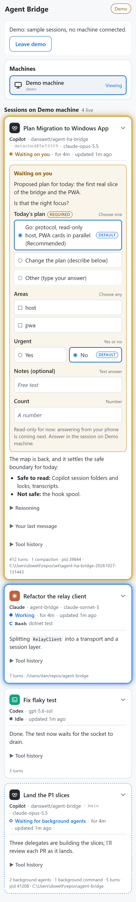

# Agent Bridge PWA

The phone client: your machines and their live agent sessions, end-to-end encrypted
through the relay. Plain ES modules and CSS, no framework, no build step, nothing from a
CDN: the page's Content-Security-Policy allows scripts and styles from this site only,
and network access to the relay only.

Published at <https://danswett.github.io/agent-bridge/app/> by `.github/workflows/pages.yml`.
Try it without a machine: [`?demo=1`](https://danswett.github.io/agent-bridge/app/?demo=1).

This slice is **read-only**: sessions, their activity and their pending questions, per
[docs/protocol/v1-sessions.md](../docs/protocol/v1-sessions.md). Answering, replying,
launching and notifications come next.

| Light | Dark |
|---|---|
|  |  |

## Modules

| File | What it does |
|---|---|
| `js/main.js` | Boot and wiring: demo or live, sign-in, the views |
| `js/identity.js` | This device's P-256 key, generated non-extractable and kept in IndexedDB; its device id |
| `js/signin.js` | GitHub device flow through the relay; the stored account |
| `js/relay.js` | One relay WebSocket: hello, key proof, presence, routed frames. A send on a dead socket throws |
| `js/connection.js` | The relay over time: reconnect with backoff, at once on `visibilitychange`/`pageshow`/`online`; stop on a refused sign-in or a takeover by another window |
| `js/channels.js` | Noise_XX_P256 channels to hosts, as the initiator, with the peer's key checked against its id |
| `js/noise-p256.js` | Vendored copy of `spikes/s2-noise-interop/web/noise-p256.js` |
| `js/protocol.js` | Op and event names, and the tolerant reader: unknown fields dropped, unknown enum values read as the C# reader reads them |
| `js/host-client.js` | The sessions protocol over any transport: requests by `id`/`re`, events by `ev`, `seq` checking, the subscription snapshot |
| `js/host-session.js` | Which host is shown, and keeping a subscription to it across reconnects; remembers the last host; honours `?host=` |
| `js/sessions-store.js` | The live sessions, most recently updated first |
| `js/markdown.js` | Markdown to DOM without HTML (see below) |
| `js/ui/*` | Session cards, the read-only question, machines list, fold state, relative times |
| `js/demo.js` | `?demo=1`: a simulated host speaking the real protocol to the real client |
| `tools/build-site.mjs` | Assembles the site for Pages: `config.js` with the relay, CSP in the page, and `sw.js` stamped with a hash of everything served, so any change reaches an open app as an update (the app then offers Reload) |

### Connecting a host

```
connection.openChannel(hostDeviceId)        // channels.js: Noise through the relay
  -> new HostClient(channel, { store })     // host-client.js
  -> client.hello()                         // needs protocol 1 and "sessions.read"
  -> client.subscribe()                     // {revision, count}, then upserts, then sessions.synced
host frames -> Channel.onmessage -> HostClient -> SessionsStore -> SessionListView
```

`HostSession.select(deviceId)` does all of that and redoes it after every reconnect. A
host needs only to answer `hello` and `sessions.subscribe` and send `session.upsert`,
`session.remove` and `sessions.synced` event frames on the channel; `session.get` feeds
the tool history. `test/e2e/fixture-host.mjs` is a working example in 120 lines.

The client resubscribes when `seq` skips, repeats or goes backwards, and replaces its
list with the snapshot when `sessions.synced` arrives; until then the previous list stays
on screen. Unknown events still count for `seq`.

### Markdown

Agent text is rendered by `js/markdown.js`, written for this app rather than vendored.
The common pairing, a Markdown library plus DOMPurify, produces an HTML string and then
parses it into the page, so safety depends on the sanitizer matching every parser quirk.
Here no string is ever parsed as HTML: the parser emits a small tree from a fixed tag
list, the DOM is built with `createElement` and text nodes, every tag and link is checked
again while building, and links keep only `http:`, `https:` and `mailto:` (absolute).
Images become links and are never loaded. It covers what agents write: paragraphs (line
breaks kept), headings, emphasis, code, fenced code, nested and task lists, quotes, rules,
GitHub tables and links. It is linear on hostile input (tested at 16 KiB).

## Tests

```
npm ci
node --test "test/unit/*.test.mjs"       # protocol client, tolerant reader, Markdown
npx playwright install chromium webkit
dotnet build ../spikes/s4-relay/src/S4.DevStack -c Release   # for test/e2e
npx playwright test                       # UI (demo mode) and E2E, Chromium and WebKit
node test/screenshots.mjs                 # docs/demo-*.png, WebKit at iPhone size
```

Locally, if the public registry is blocked:
`npm install --no-save --no-package-lock --registry https://packagefeedproxy.microsoft.io/npm/`.

Every Playwright test serves the output of `tools/build-site.mjs` under
`/agent-bridge/app/`, so the published CSP is in force and a violation fails the test.

* `test/ui.spec.mjs`, in demo mode: every field type and status from the worked example,
  glow per status, the delegating state (idle with `background` work), reduced motion,
  Markdown, an XSS payload in every text field, unknown
  status/agent/fields/events, a `seq` gap, reordering and removal, fold persistence and
  auto-unfold, truncation notes, tool history via `session.get`, the worker's scope.
* `test/e2e/e2e.spec.mjs`, through the spike dev stack's real relay with a fake GitHub:
  sign-in, key proof, presence, a Noise channel to a Node fixture host, the snapshot, live
  upserts and removes, `session.get`, recovery after the socket drops (a session that
  ended meanwhile disappears), returning to the last host, `?host=` links, and the S4
  demo host reported as not supporting sessions.

Not covered end to end: the C# Bridge Host (it is not wired yet; the fixture host speaks
the same contract), the live relay and GitHub, real phones, and Web Push.
